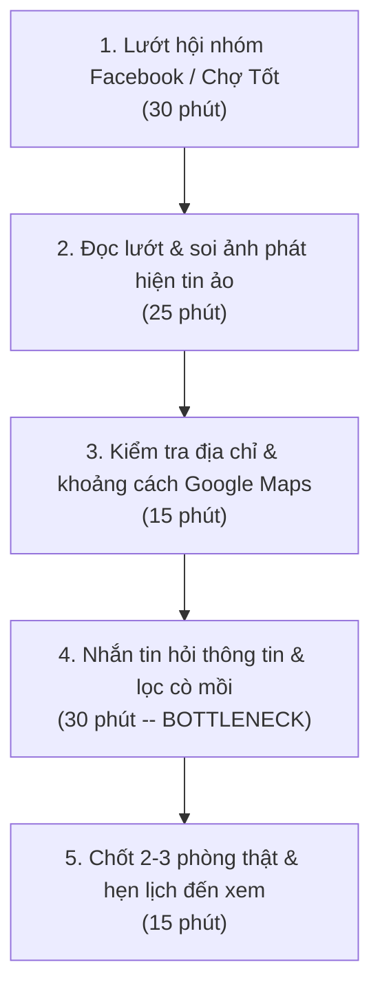
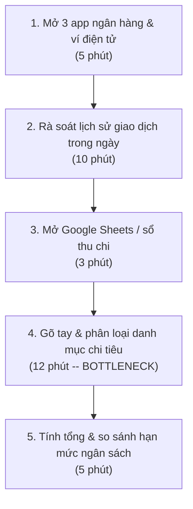
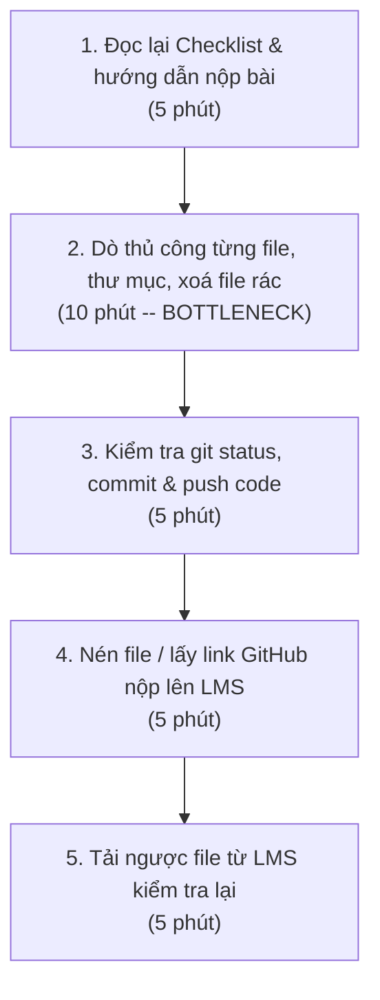

# Báo cáo cá nhân — 2A202603464_DuongMinhTan

> Đổi tên file theo quy tắc `MSSV_HoTen.md`, ví dụ `20241234_NguyenVanAn.md` (MSSV trước, dấu `_`, họ tên viết liền không dấu). Sửa cả dòng tiêu đề phía trên cho khớp.
> Template chi tiết và prompt mẫu cho từng mục: [docs/01-worksheet.md](../../docs/01-worksheet.md).
> Mỗi thành viên một file trong `report/individual/` trên repo nhóm: copy template này thành file mới, điền, rồi commit bằng tài khoản GitHub của bạn. Không viết hộ người khác.

## 1. Thông tin học viên

- Họ tên: Dương Minh Tân
- MSSV:2A202603464
- Email trường (không bắt buộc, repo có thể để public):
- Tên nhóm:NhomNhomNhom
- Link repo nhóm: https://github.com/bato-bato/K5-L3A-DAY02-NhomNhomNhom-DiscoveryProblemFraming.git

---

## 2. Scan problem (CP1)

Lăng kính: **Lặp lại** · **Tốn thời gian** · **Cần đọc, tổng hợp nhiều thông tin** · **Pain từ người khác**.

| # | Lăng kính | Job Story: Khi… tôi muốn… để… | Ai chịu ảnh hưởng? | Dấu hiệu thật (thời gian, tần suất, số người, bằng chứng) |
|---:|---|---|---|---|
| 1 | Lặp lại | Khi tôi muốn nộp bài lab hàng ngày tôi muốn soát toàn bộ checklist cách nộp bài(định dạng file, câu thư mục, commit author, link nộp) để không bị trừ điểm do vi phạm hình thức nộp bài | Học viên AI thực chiến | 1-2 lần/ngày, mất 5-10 phút rà soát thủ công tên file, link nộp bài, từng bị trừ điểm vì đặt sai format tên file |
| 2 | Lặp lại | Khi tôi chuẩn bị đi ngủ, tôi muốn ghi chép và gom các khoản chi tiêu nhỏ lẻ từ 3 ứng dụng ngân hàng và ví điện tử vào một chỗ, để theo dõi xem mình đã tiêu hết bao nhiêu tiền trong ngày mà không bị thâm hụt ngân sách tháng. | Sinh viên/người trẻ sống tự lập | 7 ngày/tuần; mỗi tối mất 10–15 phút mở app ngân hàng, MoMo, kiểm tra tin nhắn trừ tiền; cuối tháng trước bị hụt 600.000đ mà không nhớ rõ đã tiêu vào việc gì. |
| 3 | Lặp lại | Khi tôi muốn chia tiền điện, nước và tiền chợ theo số ngày mỗi người ở phòng để mọi người đóng tiền công bằng, tránh tranh cãi | Người đứng tên thuê trọ, 2 bạn cùng phòng | 1 lần/tuần, mất 15–20 phút tính toán và đối chiếu lịch; từng tranh cãi do tính nhầm 80.000đ tiền nước. |
| 4 | Tốn thời gian | Khi tôi muốn tìm phòng trọ, lọc được phòng thật, đúng ngân sách, gần trường và không chung chủ để tránh mất thời gian liên hệ môi giới hoặc phòng đã cho thuê | Sinh viên đi thuê trọ | Mất 1–2 tiếng mỗi tối trong 10 ngày tìm phòng; trong 15 bài đăng liên hệ có 9 bài là phòng ảo hoặc đã cho thuê. |
| 5 | Tốn thời gian | Khi tôi muốn tổ chức đi chơi nhóm, tìm được thời gian và địa điểm phù hợp với mọi người để nhanh chóng chốt kế hoạch, thay vì nhắn tin qua lại nhiều ngày | Người đứng ra tổ chức nhóm bạn | 3–4 tháng/lần, mất 2–3 ngày thống nhất lịch và địa điểm; từng phải hủy kế hoạch do không tìm được giờ phù hợp. |
| 6 | Cần đọc, tổng hợp nhiều thông tin | Khi tôi muốn mua đồ công nghệ hoặc gia dụng, tổng hợp đánh giá từ nhiều nguồn để biết sản phẩm có tốt và bền không, tránh mua phải hàng kém chất lượng hoặc review ảo | Người mua sắm trực tuyến | Mất 3–4 tiếng đọc đánh giá trên nhiều nền tảng; từng mua bàn phím cơ bị liệt phím sau một tháng dù có nhiều đánh giá tốt. |
| 7 | Cần đọc, tổng hợp nhiều thông tin | Khi tôi muốn làm thủ tục hành chính, biết cần chuẩn bị giấy tờ gì và thực hiện những bước nào để tránh thiếu hồ sơ và phải đi lại nhiều lần | Công dân/sinh viên ở trọ ngoại tỉnh | Từng mất 3 ngày làm thủ tục tạm trú và phải nộp lại hồ sơ 2 lần do thiếu giấy xác nhận của chủ nhà. |
| 8 | Cần đọc, tổng hợp nhiều thông tin | Khi tôi muốn mua thực phẩm, so sánh nhanh lượng calo, đường và chất béo giữa các sản phẩm để chọn loại phù hợp với chế độ ăn uống của mình | Người quan tâm đến sức khỏe/tập gym | Khoảng 2 lần/tuần, mất thêm 30–40 phút đọc nhãn sản phẩm; từng mua nhầm thực phẩm có lượng đường cao gấp đôi dự kiến. |
| 9 | Pain từ người khác | Khi tôi muốn đặt hàng online, biết trước thời gian shipper giao đến để chủ động sắp xếp người nhận, tránh bỏ lỡ đơn hoặc khiến shipper phải chờ lâu | Người mua hàng online, shipper giao hàng | 3–4 đơn/tuần, thường bỏ lỡ 2–3 cuộc gọi khi đang học; từng bị hủy đơn do không thể nhận hàng kịp thời. |
| 10 | Pain từ người khác | Khi tôi muốn hướng dẫn bố mẹ sử dụng các thiết bị công nghệ từ xa từng bước dễ hiểu để bố mẹ có thể tự thao tác mà không cần gọi hỏi nhiều lần | Bố mẹ lớn tuổi, con cái đi học xa nhà | 2–3 lần/tháng, mỗi lần hỗ trợ mất 25–40 phút; từng xảy ra trường hợp mẹ chuyển nhầm số tài khoản do thao tác sai. |

**Nếu có dùng AI để gợi ý thêm:** ý nào AI gợi ý mà bạn giữ lại, ý nào bỏ và vì sao.

- **Ý giữ lại:** Giữ lại Ý #4 *(lọc tin tìm phòng trọ tránh cò mồi)* và Ý #10 *(hỗ trợ bố mẹ lớn tuổi thao tác ứng dụng từ xa)* vì đây là các nỗi đau rất thực tế trong đời sống sinh hoạt của sinh viên/người trẻ sống xa nhà, có tần suất và số liệu kiểm chứng rõ ràng.
- **Ý loại bỏ:** Bỏ gợi ý *"Một trợ lý tự động đi chợ và nấu ăn thay cho cả phòng trọ"* vì đây là ý tưởng bất khả thi về mặt thực tế, tư duy theo giải pháp viễn vông và không phản ánh đúng quy trình sinh hoạt thường ngày.

---

## 3. Top 3 Problem Cards + quy trình nháp (CP2)

### Bảng chọn top 3

| Rank | Problem | Vì sao chọn | Điều còn chưa chắc |
|---|---|---|---|
| 1 | Tìm phòng trọ: Lọc tin thật, loại bỏ tin môi giới/cò phòng ảo (#4) | Nỗi đau đời sống rất lớn và cấp thiết của sinh viên; quy trình sàng lọc nhiều bước tốn thời gian; bottleneck phân loại bài đăng rất cụ thể; dễ so sánh Rule vs Workflow. | Bài đăng trên mạng xã hội có nhiều tiếng lóng, viết tắt và hình thức lừa đảo/cò mồi thay đổi liên tục. |
| 2 | Quản lý chi tiêu: Gom và đối soát chi tiêu nhỏ lẻ từ nhiều app ví/ngân hàng (#2) | Tần suất lặp lại hằng ngày (7 ngày/tuần); quy trình đối chiếu rõ ràng; đo được số phút và số tiền thất thoát baseline. | Vấn đề bảo mật thông tin tài chính cá nhân và quyền riêng tư khi xử lý tin nhắn biến động số dư. |
| 3 | Nộp bài: Đối soát checklist quy chuẩn nộp bài lab trước deadline (#1) | Tần suất lặp lại hàng tuần; rủi ro trừ điểm hình thức nặng; quy trình kiểm tra các file rất cụ thể; là bài toán điển hình để so sánh No AI/Rule với AI. | Mỗi môn học có format nộp bài khác nhau, liệu có cần AI hay chỉ cần một đoạn script định sẵn là đủ? |

### Problem Card #1

| Trường | Nội dung |
|---|---|
| Job Story | Khi cần tìm phòng trọ mới để chuyển chỗ ở, tôi muốn lọc ra các phòng trọ thực tế đúng theo ngân sách, bán kính 3km quanh trường và không chung chủ từ hàng chục bài đăng trên mạng xã hội, để hẹn lịch đi xem phòng thật mà không bị mất thời gian bởi bài đăng của môi giới/cò phòng ảo. |
| Actor | Sinh viên, người trẻ đi thuê phòng trọ |
| Thời điểm / bối cảnh | Trước khi hết hạn hợp đồng nhà cũ khoảng 2–3 tuần (thường vào đầu kỳ học mới hoặc cuối năm) |
| Quy trình hiện tại (3–7 bước) | 1. Tham gia và lướt các hội nhóm tìm trọ trên Facebook/Chợ Tốt (30 phút) 2. Đọc lướt nội dung, soi ảnh phòng để phát hiện ảnh mẫu studio của môi giới (25 phút) 3. Kiểm tra địa chỉ thực tế và tính toán khoảng cách đi lại bằng Google Maps (15 phút) 4. Nhắn tin hỏi chủ bài đăng về giá điện nước, giờ giấc và tình trạng phòng còn hay đã hết (30 phút) 5. Lọc ra 2–3 phòng thật và hẹn lịch chủ nhà đến xem trực tiếp (15 phút) |
| Bottleneck (bước nào, mất bao nhiêu phút) | Bước 4 (Nhắn tin hỏi chủ bài đăng và chờ phản hồi để xác nhận phòng thật hay cò mồi): mất 30 phút/buổi, tỷ lệ nhận được tin nhắn báo "phòng này hết rồi, mình còn phòng khác tương tự" chiếm hơn 60% |
| Impact (nếu không giải thì sao) | Mất 10–15 ngày tìm kiếm, kiệt sức vì đi xem nhầm phòng xấu/ảo, nguy cơ bị lừa cọc hoặc phải thuê tạm phòng đắt kém chất lượng |
| Success metric (baseline → target) | Baseline: 115 phút/ngày, mất 10 ngày tìm được 3 phòng thật để đi xem. Target: Dưới 30 phút/ngày, trong 3 ngày chọn được 3 phòng chuẩn để hẹn xem trực tiếp. Cách đo: Thời gian tìm kiếm mỗi ngày và số lượng cuộc hẹn xem phòng thật. |
| Phương án không dùng AI | Dùng bộ lọc có sẵn của các website bất động sản (Batdongsan, Phongtro123) hoặc nhờ bạn bè/người quen giới thiệu |
| Giả thuyết về AI (nếu có) | AI hỗ trợ phân tích nội dung bài post (phát hiện mẫu câu môi giới, bóc tách giá điện nước, diện tích) và kiểm tra ngược ảnh phòng trùng lặp trên mạng |
| Cảm nhận nhanh | Workflow (AI trích xuất thông tin bài đăng và gắn nhãn độ tin cậy, con người quyết định liên hệ) |

Quy trình nháp hiện tại:

### Problem Card #2

| Trường | Nội dung |
|---|---|
| Job Story | Khi cuối ngày chuẩn bị đi ngủ, tôi muốn ghi chép và gom các khoản chi tiêu nhỏ lẻ từ 3 ứng dụng ngân hàng và ví điện tử vào một chỗ, để theo dõi xem mình đã tiêu hết bao nhiêu tiền trong ngày mà không bị thâm hụt ngân sách tháng. |
| Actor | Sinh viên, người trẻ sống tự lập tự quản lý tài chính |
| Thời điểm / bối cảnh | 22h00 – 23h00 mỗi tối trước khi đi ngủ |
| Quy trình hiện tại (3–7 bước) | 1. Mở lần lượt 3 ứng dụng (Vietcombank, MoMo, ZaloPay) (5 phút) 2. Xem lịch sử biến động số dư và ghi nhớ các khoản chi trong ngày (10 phút) 3. Mở ứng dụng ghi chép sổ thu chi hoặc Google Sheets trên điện thoại (3 phút) 4. Nhập từng khoản tiền và phân loại thủ công vào danh mục (ăn uống, đi lại, đồ dùng) (12 phút) 5. Tính tổng số tiền đã tiêu trong ngày và so sánh với hạn mức ngân sách ngày (5 phút) |
| Bottleneck (bước nào, mất bao nhiêu phút) | Bước 4 (Nhập từng khoản tiền và nhớ lại mục đích chi tiêu để phân loại): mất 12 phút, hay bị quên khoản tiền mặt nhỏ hoặc lười nhập khi có nhiều giao dịch lẻ |
| Impact (nếu không giải thì sao) | Bỏ dở việc theo dõi chi tiêu sau 1–2 tuần, thâm hụt tài chính cuối tháng (trung bình hụt 100-400k không rõ nguyên nhân), căng thẳng tài chính |
| Success metric (baseline → target) | Baseline: 35 phút/ngày ghi chép thủ công, tỷ lệ duy trì sổ sách dưới 40% số ngày trong tháng. Target: Dưới 3 phút/ngày, duy trì theo dõi đều đặn 90% số ngày trong tháng. Cách đo: Thời gian ghi chép mỗi tối và số ngày ghi chép đầy đủ trong tháng. |
| Phương án không dùng AI | Chỉ dùng 1 tài khoản/thẻ duy nhất cho mọi chi tiêu và đặt hạn mức cảnh báo số dư trên app ngân hàng |
| Giả thuyết về AI (nếu có) | AI phân loại tự động nội dung giao dịch (chuyển tiền ăn, tiền xăng) vào đúng danh mục chi tiêu qua ảnh chụp màn hình lịch sử giao dịch |
| Cảm nhận nhanh | Rule / Workflow (Quy tắc tự động phân loại theo từ khóa, AI chỉ hỗ trợ đoán các nội dung không rõ ràng) |

Quy trình nháp hiện tại:

### Problem Card #3

| Trường | Nội dung |
|---|---|
| Job Story | Khi chuẩn bị nộp bài tập lớn/lab hàng tuần trên GitHub và hệ thống nộp bài LMS, tôi muốn đối soát toàn bộ checklist quy cách nộp (định dạng tên file, cây thư mục, commit author, link nộp), để không bị trừ điểm oan do vi phạm quy chế hình thức. |
| Actor | Sinh viên, học viên thực hành kỹ thuật/AI |
| Thời điểm / bối cảnh | 30–60 phút trước hạn chót nộp bài lab (23h59) |
| Quy trình hiện tại (3–7 bước) | 1. Mở file đề bài đọc lại mục Checklist & hướng dẫn nộp bài (5 phút) 2. Dò thủ công từng file, thư mục, xoá file rác hệ thống (.DS_Store, cache) (10 phút) 3. Kiểm tra git status, git log commit author và push code lên repo (5 phút) 4. Đóng gói file nén hoặc copy link GitHub dán vào LMS (5 phút) 5. Đăng nhập LMS tải ngược file về để đối chiếu tính toàn vẹn (5 phút) |
| Bottleneck (bước nào, mất bao nhiêu phút) | Bước 2 (Dò thủ công từng tên file, đường dẫn và xóa file rác): mất 10 phút, dễ hoa mắt nhầm lẫn dấu gạch dưới `_` với gạch nối `-` |
| Impact (nếu không giải thì sao) | Bị trừ 5–10% tổng điểm chỉ vì lỗi cú pháp tên file hoặc thiếu 1 file readme/tác giả dù code làm đúng |
| Success metric (baseline → target) | Baseline: 30 phút kiểm tra thủ công, tỷ lệ rủi ro trừ điểm hình thức 10%. Target: Dưới 3 phút, 0% vi phạm lỗi quy cách nộp bài. Cách đo: Thời gian kiểm tra trước khi bấm submit và số lần bị trừ điểm format trong kỳ. |
| Phương án không dùng AI | Viết một bash script hoặc file Python kiểm tra regex tên file, sự tồn tại của các file bắt buộc và trạng thái git |
| Giả thuyết về AI (nếu có) | Không cần AI; các quy tắc kiểm tra hoàn toàn là kiểm tra cú pháp và cấu trúc định sẵn (Deterministic rules) |
| Cảm nhận nhanh | Rule (Script tự động hóa hoàn toàn đủ đáp ứng) |

Quy trình nháp hiện tại:

### Card muốn pitch nhất

- Card số: Card #1 (Tìm phòng trọ: Lọc tin thật, loại bỏ tin môi giới/cò phòng ảo)
- Vì sao: Đây là bài toán đời sống cực kỳ gần gũi với sinh viên; quy trình hiện tại gồm nhiều bước thủ công tốn thời gian; điểm nghẽn nhận diện tin giả/cò mồi rất rõ ràng; và là bài toán có sự kết hợp thú vị giữa Rule và Workflow xử lý ngôn ngữ tự nhiên.
- Câu hỏi muốn nhóm phản biện: "Làm thế nào để phân biệt chính xác một bài đăng là của chủ nhà thật hay của môi giới đăng ảnh ảo khi mà môi giới ngày càng dùng văn phong giống hệt người thuê nhà?"

### AI đã phản biện card thế nào

| Điểm yếu AI chỉ ra | Đồng ý? | Đã sửa gì |
|---|---|---|
| Metric ban đầu "tìm phòng nhanh hơn và đỡ mệt hơn" là định tính, không thể đo lường được. | Đồng ý | Đã sửa lại thành Success Metric định lượng: "Giảm thời gian từ 115 phút/ngày xuống dưới 30 phút/ngày; chốt được 3 phòng thật để hẹn xem trực tiếp trong vòng 3 ngày thay vì 10 ngày". |
| Đề xuất ban đầu định dùng AI tự động nhắn tin đặt cọc phòng trọ cho người dùng là quá nguy hiểm (rủi ro lừa đảo cao). | Đồng ý | Đã giới hạn rõ ranh giới (Boundary): AI chỉ hỗ trợ trích xuất thông tin và gắn nhãn cảnh báo độ tin cậy; việc liên hệ, xem phòng và đặt cọc 100% do con người trực tiếp thực hiện. |
| Bước nghẽn ban đầu chỉ ghi chung chung là "khâu tìm kiếm mất thời gian". | Đồng ý | Đã làm rõ bottleneck là "Bước 4: Nhắn tin hỏi thông tin và chờ phản hồi để xác định phòng thật hay cò mồi (30 phút/buổi, hơn 60% là tin ảo)". |

---

## 4. Tôi đã tham gia phần nào (CP3 → CP7)

| Hoạt động | Tôi đã làm gì? | Kết quả / ảnh hưởng tới bài nhóm |
|---|---|---|
| Pitch Problem Card | Trình bày 3 card cá nhân: Lọc tin trọ (#4), Gom chi tiêu (#5), Soát checklist lab (#6). | Bài #4 vào shortlist chấm điểm; bài #6 được xếp vào nhóm thuần Rule. |
| Phản biện bài của bạn khác | Hỏi Bảo (#1): *"Tuyển thủ thiếu thông tin hay bị trôi khó tìm? Trang Notion FAQ tập trung có đủ không?"* | Nhóm đưa câu hỏi "Trang FAQ tĩnh (No AI) có đủ không?" vào Assumption Map (CP4) để kiểm chứng. |
| Nhận phản biện | Bảo hỏi bài tìm trọ (#4): *"Facebook chặn scraping thì lấy bài thế nào? Cò viết như người thật thì AI có lọc nhầm không?"* | Tôi sửa lại Boundary card #4: AI chỉ gắn nhãn cảnh báo, người dùng tự quyết định liên hệ. |
| Gom cluster / cây OST | Cùng nhóm gom 12 candidate thành 3 cluster (A, B, C) và viết cây OST. | Gạch bỏ 2 solution đội lốt (*"Chatbot AI"*, *"App giải đấu"*), giữ lại 3 nhánh thuần pain. |
| Chọn candidate problem | Chấm điểm shortlist và đồng thuận chọn bài #1 (Giải đấu XAY MAJOR) của Bảo thay vì bài tìm trọ. | Nhóm chốt bài #1 (34/35 điểm) vì có sẵn người dùng thật tại CLB để khảo sát ngay. |
| Kiểm chứng / research | Lập Assumption Map; rà soát log câu hỏi gửi BTC và tìm hiểu Discord FAQ, Battlefy, Dify RAG. | Xác nhận đa số câu hỏi lặp lại là về lịch/thể lệ; thống nhất phải chuẩn hóa 1 nguồn dữ liệu gốc của BTC trước. |
| Quy trình nhóm | Vẽ sơ đồ quy trình Hiện tại & Tương lai bằng Mermaid, lập bảng Before/After. | Chỉ rõ bottleneck chờ BTC trả lời (20–45'); thêm bước Rule lọc khiếu nại chuyển Trọng tài (HITL) và fallback. |
| Problem Statement | Cùng nhóm viết Problem Statement v0 và cập nhật lên v1. | Thêm metric chất lượng ở v1: 100% câu trả lời có dẫn nguồn điều khoản, 0% dùng thông báo cũ. |
| Mức can thiệp AI | So sánh 4 mức (No AI / Rule / Workflow / Agent) và trả lời 2 câu hỏi PAIR. | Chốt mức Workflow; thống nhất "Báo nhầm tệ hơn bỏ sót" vì báo sai lịch làm tuyển thủ bị xử thua. |
| Quyết định | Đánh giá 4 rủi ro và đề xuất ngưỡng dừng cho pilot. | Chốt "Go, phạm vi nhỏ" kèm ngưỡng dừng: báo sai lịch/luật dù chỉ 1 lần thì dừng bot, quay về FAQ tĩnh. |

---

## 5. Dùng AI

| Checkpoint | Tôi dùng AI để làm gì? | AI hữu ích ở đâu? | AI sai hoặc hời hợt ở đâu? | Tôi sửa gì bằng nhận định của mình? |
|---|---|---|---|---|
| CP1 Scan | Gợi ý thêm vấn đề theo 4 lăng kính và chỉnh format Job Story. | Mở rộng góc nhìn ngoài học tập (tìm trọ, hỗ trợ người thân). | Đưa ra một số ý solution-first ("chatbot nấu ăn", "AI làm bài tập"). | Bỏ các ý viễn vông, tự điền số liệu thời gian/tần suất từ trải nghiệm thật. |
| CP2 Problem Card | Đóng vai PM hoài nghi phản biện card và vẽ sơ đồ Mermaid. | Chỉ ra metric ban đầu còn cảm tính và rủi ro nếu để AI tự quyết. | Thiên về hướng "Agent tự động hóa hoàn toàn", thiếu an toàn thực tế. | Giữ Boundary: AI chỉ trích xuất & gắn nhãn cảnh báo, con người duyệt (HITL); sửa metric thành định lượng. |
| CP4 Research | Tìm công cụ hỗ trợ giải đấu Esports và hỏi đáp tài liệu (RAG). | Gợi ý nhanh Discord Forum FAQ, Battlefy, Dify RAG. | Gợi ý bot tự xử lý cả khiếu nại trận đấu; một số link bị cũ. | Tự mở kiểm tra từng link; bỏ ý để AI xử lý khiếu nại, chỉ giới hạn tra cứu điều lệ/lịch. |
| CP5 Quy trình | Chuyển mô tả quy trình thành sơ đồ Mermaid. | Vẽ flowchart nhanh, rõ các bước trước/sau. | Gộp chung câu hỏi thường và khiếu nại vào một luồng AI, thiếu fallback. | Tách bước Rule chuyển khiếu nại cho Trọng tài (HITL) và thêm fallback về trang FAQ gốc. |
| CP5–6 Problem Statement | Nhờ AI bắt lỗi bản Problem Statement v0. | Chỉ ra v0 mới đo tốc độ trả lời, chưa đo độ chính xác. | Gợi ý metric cảm tính ("tuyển thủ hài lòng hơn") khó đo. | Sửa thành metric đo được: 100% câu trả lời có trích dẫn mục điều lệ, 0% dùng thông báo cũ. |
| CP6 Mức can thiệp / quyết định | So sánh 4 mức can thiệp và rà soát 4 rủi ro. | Hệ thống hóa nhanh bảng AI Canvas và tiêu chí eval. | Khuyến khích chọn Agent tự cập nhật lịch từ nhiều kênh chat. | Giữ mức Workflow (trên 1 nguồn chuẩn của BTC) để tránh lấy nhầm tin cũ; tự chốt ngưỡng dừng. |

---

## 6. Reflection (CP7)

Trả lời bằng trải nghiệm thật của bạn, tối thiểu 200 từ cho các câu 6.1–6.6 (không tính 6.7, câu này được chấm riêng ở tiêu chí C5). **Không dùng AI để viết thay.**

**6.1. Tôi học được gì khi nghe top 3 problems của các bạn khác?**
Khi nghe các bạn trình bày top 3 problems mình nhận ra một bài toán tốt trong phạm vi lab không cần phạm vi quá lớn mà quan trọng là có người dùng thật và giải quyết được painpoint của nhóm người dùng đó.

**6.2. Nhóm có lúc nào bị "solution-first" (nghĩ giải pháp trước khi hiểu vấn đề) không? Lúc đó nhóm nhận ra và xử lý thế nào?**
Có ngay lúc đầu khi chốt chọn bài làm chat bot giải đấu Esport cả nhóm đã nghĩ tới việc làm con chat bot trên discord để tự trả lời câu hỏi về thể thức giải đấu cho tuyển thủ. Nhưng khi ngồi vẽ cây OST mới nhận ra nếu BTC giải đấu chưa có một nguồn thông tin chuẩn duy nhất thì chatbot AI cũng sẽ xảy ra trường hợp lấy nhầm thông báo. Vì vậy phải quay lại gốc vấn đề là chuẩn hóa một trang thông tin gốc của BTC trước.

**6.3. Tôi có đổi ý sau khi bị phản biện không? Kể một lần cụ thể.**
Mình đã đổi ý ở cả bài cá nhân lẫn khi chọn bài nhóm. Lúc đầu mình rất muốn giữ bài "Lọc tin tìm phòng trọ tránh cò ảo" làm bài chính. Nhưng khi Bảo hỏi: "Group Facebook chặn cào dữ liệu thì lấy bài thế nào? Văn phong cò mồi giờ giống hệt sinh viên nhượng phòng thì AI lọc nhầm phòng thật tính sao?", mình thấy rủi ro kỹ thuật và rủi ro lọc nhầm đều quá lớn. Mình đã sửa lại Boundary của card (chỉ gắn nhãn cảnh báo chứ không tự ẩn bài) và đồng ý chọn bài giải đấu XAY MAJOR của Bảo làm bài nhóm.

**6.4. Kết quả kiểm chứng (phỏng vấn/survey/research) có làm tôi bất ngờ không? Điều gì?**
Mình khá bất ngờ khi đối chiếu các câu hỏi tuyển thủ gửi về BTC: trước đó mình tưởng tuyển thủ chỉ lười đọc nên mới hỏi lại, nhưng thực tế nhiều bạn đã đọc bài đăng trên Fanpage rồi mà vẫn phải nhắn hỏi BTC vì sợ lịch thi đấu hoặc bảng đấu vừa bị đổi trong nhóm chat Zalo mà mình bị trôi tin nhắn không biết. Tức là nỗi đau lớn nhất nằm ở việc "không chắc thông tin mình đang xem có phải bản mới nhất hay không".

**6.5. Điều khó nhất khi viết Problem Statement là gì?**
Khó nhất là viết phần Success Metric và Boundary sao cho cụ thể, không bị chung chung. Lúc đầu nhóm rất dễ viết kiểu "giúp tuyển thủ tìm thông tin nhanh hơn, giảm tải cho BTC", sau đó phải sửa lại thành con số đo được và thêm điều kiện bắt buộc: 100% câu trả lời của AI phải trích dẫn rõ mục nào trong điều lệ và không được dùng thông báo cũ đã hết hiệu lực.

**6.6. Nếu làm lại, tôi sẽ đổi gì? Tôi sẽ phản biện nhóm mạnh hơn ở điểm nào?**
Nếu làm lại, mình sẽ khảo sát thêm các bạn tuyển thủ ở những đội mới tham gia lần đầu xem họ vướng ở bước đăng ký hay bước xem lịch nhiều hơn. Ngoài ra, mình sẽ phản biện kỹ hơn về quy trình vận hành của BTC: ai trong CLB sẽ chịu trách nhiệm cập nhật file điều lệ/lịch đấu gốc khi có thay đổi đột xuất sát giờ thi đấu, vì nếu người phụ trách quên cập nhật file gốc thì hệ thống tra cứu cũng sẽ sai theo.

**6.7. Hiểu bài:** giải thích bằng 5–8 câu, không nhìn tài liệu, chuỗi *problem → quy trình → metric → boundary → mức can thiệp AI → quyết định* của bài nhóm mình.
Bài toán của nhóm là giải quyết việc tuyển thủ giải XAY MAJOR 2026 khó tìm lịch thi đấu, thể lệ bị trôi trên các kênh chat và phải chờ BTC trả lời lặp lại mất 20–45 phút. Quy trình mới bắt đầu bằng việc BTC chuẩn hóa một file nguồn duy nhất, sau đó hệ thống dùng Rule chuyển câu hỏi khiếu nại cho Trọng tài và dùng AI trích xuất câu trả lời kèm nguồn cho câu hỏi tra cứu. Mục tiêu là giảm thời gian chờ xuống dưới 1 phút, giảm hơn 80% câu hỏi lặp lại, đồng thời đảm bảo 100% câu trả lời có dẫn nguồn và 0% dùng tin cũ. Ranh giới là AI chỉ trích xuất từ tài liệu mới nhất của BTC, không tự xử lý khiếu nại hay đổi người và chuyển Trọng tài nếu câu hỏi ngoài tài liệu. Nhóm chọn mức Workflow để hiểu được câu hỏi tự nhiên của tuyển thủ mà vẫn kiểm soát chặt chẽ nguồn dữ liệu hơn Agent. Quyết định là Go phạm vi nhỏ để pilot ở vòng bảng, kèm ngưỡng dừng nếu báo sai lịch hoặc luật dù chỉ một lần thì sẽ dừng bot ngay và quay về trang FAQ tĩnh.

---

## 7. Tài liệu tham khảo

- Tài liệu hướng dẫn Lab Day 02: [docs/01-worksheet.md](../../docs/01-worksheet.md) và [docs/02-deliverable-example.md](../../docs/02-deliverable-example.md).
- Rob Fitzpatrick, *The Mom Test: How to talk to customers & learn if your business is a good idea when everyone is lying to you* (2013).
- Google People + AI Research (PAIR), *People + AI Guidebook*: https://pair.withgoogle.com/guidebook/.
