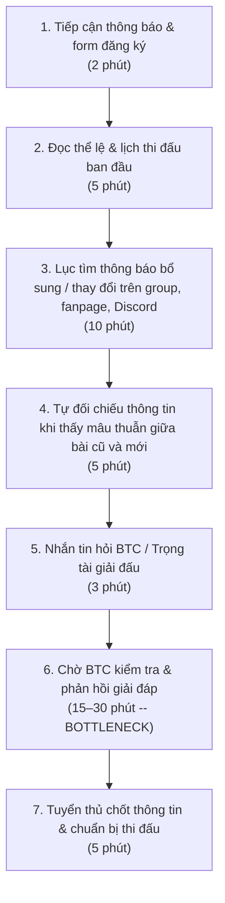
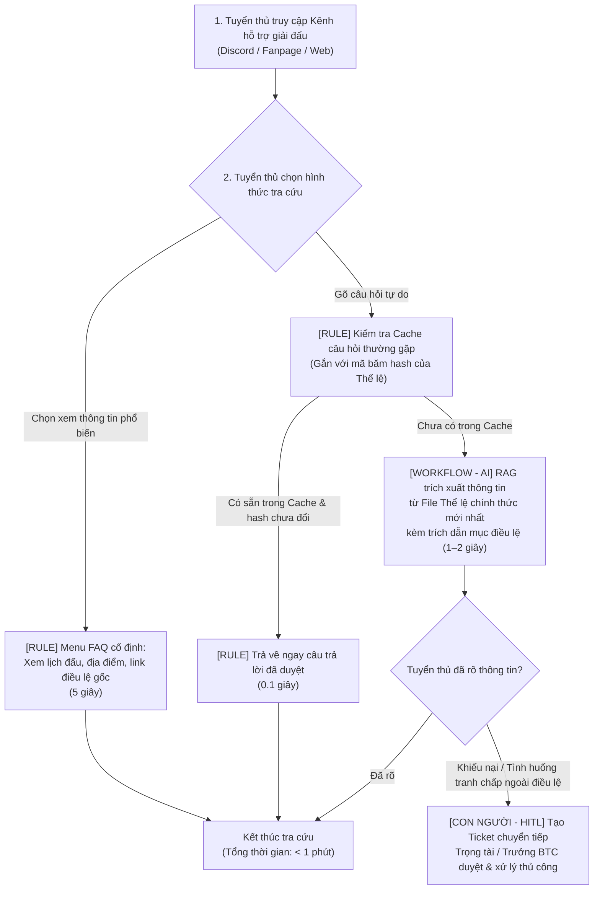

# Báo cáo nhóm — Day 02 Discovery & Problem Framing

> Bản chung của nhóm, viết trên repo do nhóm trưởng fork. Không copy file này sang repo cá nhân.
> Template chi tiết và prompt mẫu: [docs/01-worksheet.md](../../docs/01-worksheet.md). Bài mẫu: [docs/02-deliverable-example.md](../../docs/02-deliverable-example.md).

## 1. Thông tin nhóm

- Tên nhóm: NhomNhomNhom
- Thành viên: xem `TEAM.md`
- Candidate problem được chọn (1 câu): Người tham gia (tuyển thủ) khó tiếp cận thông tin chính xác, đầy đủ và cập nhật của các giải đấu Esports do CLB XayGame tổ chức.
- Quyết định cuối: Go / Not Yet / No-Go

---

## 2. Hội tụ nhóm (CP3)

### 2.1. Pitch

| # | Người đưa ra | Candidate (Job Story ngắn) | Actor | Bottleneck | Câu hỏi phản biện nhận được (ai hỏi) |
|---:|---|---|---|---|---|
| 1 | | | | | |
| 2 | | | | | |
| 3 | | | | | |
| 4 | | | | | |
| 5 | | | | | |
| 6 | | | | | |
| 7 | | | | | |
| 8 | | | | | |
| 9 | | | | | |
| 10 | | | | | |
| 11 | | | | | |
| 12 | | | | | |

### 2.2. Cluster

| Cluster | Các candidate | Pattern chung |
|---|---|---|
| A | | |
| B | | |
| C | | |

### 2.3. Opportunity Solution Tree rút gọn

Gốc là **1 outcome**. Nhánh là **opportunity** (nhu cầu, pain), không phải tính năng hay công cụ.

```text
OUTCOME: 
├── Opportunity A: 
├── Opportunity B: 
└── Opportunity C: 
```

Những ý đã gạch bỏ vì là solution đội lốt opportunity:

-

### 2.4. Chấm điểm shortlist (1–5)

| Candidate | Actor rõ | Quy trình rõ | Pain có bằng chứng | Impact đo được | Vừa sức lab | So sánh được No AI/Rule/Workflow/Agent | Nhóm hiểu domain | Tổng |
|---|---:|---:|---:|---:|---:|---:|---:|---:|
| | | | | | | | | |
| | | | | | | | | |
| | | | | | | | | |

**Candidate được chọn:**

**Vì sao chọn:**

**Vì sao loại các candidate còn lại:**

**Xử lý bất đồng (nếu có):**

---

## 3. Kiểm chứng + research giải pháp đã có (CP4)

### 3.1. Assumption Map

| # | Giả định | Loại (Value / Usability / Feasibility / Viability) | Quan trọng (1–5) | Đã có bằng chứng (1–5) | Kiểm chứng trước? |
|---:|---|---|---:|---:|---|
| 1 | | | | | |
| 2 | | | | | |
| 3 | | | | | |
| 4 | | | | | |
| 5 | | | | | |
| 6 | | | | | |

*Điền 4–6 giả định; xóa dòng thừa.*

Giả định nhóm kiểm chứng trong buổi này:

### 3.2. Kiểm chứng

Cách đã dùng: Phỏng vấn / Survey / Log, ticket, review

Interview snapshot (mỗi buổi phỏng vấn một bảng, hoặc đặt file trong `report/assets/cp4-interview-snapshot-N.md`):

| Trường | Nội dung |
|---|---|
| Người được hỏi (vai trò, không ghi tên thật) | |
| Câu nói đáng nhớ nhất (nguyên văn) | |
| Lần gần nhất gặp vấn đề này: chuyện gì đã xảy ra? | |
| Hiện đang xử lý bằng cách nào (workaround)? | |
| Mất bao lâu, bao lần? | |
| Insight / opportunity rút ra | |

Tổng hợp:

| Nguồn | Số người / số mẫu | Tín hiệu xác nhận | Tín hiệu phản bác |
|---|---:|---|---|
| | | | |

**Nhóm đã sửa problem thế nào sau kiểm chứng:**

### 3.3. Research giải pháp đã có

| Công cụ / case / pattern | Link | Giải bước nào trong quy trình? | Điểm mạnh | Khoảng trống / rủi ro | Bài học cho nhóm |
|---|---|---|---|---|---|
| | | | | | |
| | | | | | |
| | | | | | |

---

## 4. Quy trình trước/sau (CP5)

### 4.1. Quy trình hiện tại



| Bước | Actor | Input | Output | Thời gian / tần suất | Ghi chú |
|---:|---|---|---|---|---|
| 1 | Tuyển thủ | Bài đăng fanpage, thông báo Discord | Nắm được giải đấu và link form đăng ký | 2 phút / 1 lần đầu giải | Nguồn tin ban đầu thường phân tán qua nhiều kênh |
| 2 | Tuyển thủ | File PDF điều lệ, bài đăng thể thức | Nắm khung lịch thi đấu và luật chung | 5 phút / 1–2 lần | Đọc lướt, chưa nhớ hết các điều khoản chi tiết |
| 3 | Tuyển thủ | Kênh chat Discord, bài đính chính trên group | Tìm kiếm thông báo mới nhất khi có thay đổi | 10 phút / 2–3 lần mỗi giai đoạn giải | Thông báo trôi trong kênh chat, khó biết bản nào là mới nhất |
| 4 | Tuyển thủ | Các bài đăng cũ và mới | Phát hiện mâu thuẫn hoặc chưa rõ quy định | 5 phút / mỗi khi có thắc mắc | Hoang mang không biết áp dụng theo quy định nào |
| 5 | Tuyển thủ | Câu hỏi thắc mắc của đội | Tin nhắn gửi về Fanpage/Discord BTC | 3 phút / 1–2 lần mỗi đội | Thường hỏi dồn dập vào sát giờ thi đấu hoặc giờ check-in |
| 6 | Tuyển thủ & BTC | Tin nhắn hỏi của tuyển thủ | Câu trả lời xác nhận từ BTC/Trọng tài | 15–30 phút (BOTTLENECK) | BTC bị quá tải câu hỏi lặp lại; tuyển thủ phải chờ đợi sốt ruột |
| 7 | Tuyển thủ | Câu trả lời đã xác nhận | Kế hoạch tham gia, check-in đúng giờ | 5 phút | Hoàn tất chuẩn bị |

**Bottleneck chính:**
Bước 5 và 6 — Khâu nhắn tin hỏi BTC và chờ BTC đối chiếu trả lời (mất 15–30 phút/lần, cá biệt sát giờ thi đấu có thể lâu hơn do BTC quá tải). Tuyển thủ bị động, lo lắng bị xử thua do trễ giờ check-in hoặc vi phạm thể lệ; BTC mất nhiều nhân lực trả lời đi trả lời lại các câu hỏi đã có trong văn bản.

### 4.2. Quy trình tương lai



**Quy định các bước và phân định công nghệ:**
- **`[RULE]` (Bước 2, Bước 3):**
  - Cung cấp Menu FAQ cố định (các nút bấm chọn nhanh: Lịch thi đấu hôm nay, Danh sách bảng đấu, Link Rulebook gốc, Quy định check-in).
  - Tự động kiểm tra Semantic Cache: Nếu câu hỏi đã có người hỏi và mã băm (`doc_hash`) của tài liệu Thể lệ chưa thay đổi $\rightarrow$ lấy câu trả lời từ Cache trả về tức thì (0.1s), không tốn chi phí gọi AI.
  - Khi BTC cập nhật Thể lệ $\rightarrow$ mã băm thay đổi $\rightarrow$ tự động xóa Cache cũ để tránh trả lời nhầm luật cũ.
- **`[WORKFLOW - AI]` (Bước 4):**
  - Khi câu hỏi chưa có trong Cache, AI (RAG) chỉ đọc dữ liệu từ **File Thể lệ chính thức mới nhất** được BTC xác nhận để trả lời ngắn gọn, đúng trọng tâm và **bắt buộc đính kèm nguồn** (ví dụ: *"Theo Mục 3.2 - Thể lệ XAY MAJOR 2026..."*).
- **`[CON NGƯỜI - HITL]` (Bước 5):**
  - Trọng tài/BTC luôn giữ quyền kiểm soát tối cao. Với các câu hỏi khiếu nại kết quả, tố cáo gian lận, đổi người ngoài quy định, hệ thống tự động gắn cờ (flag) và chuyển tiếp cho Trọng tài giải quyết thủ công.

**BOUNDARY (Ranh giới an toàn của AI):**
- AI **tuyệt đối KHÔNG** tự ý đưa ra phán quyết xử thua, xử phạt, hủy kết quả trận đấu hoặc giải quyết các tranh chấp giữa các đội (các việc này 100% thuộc thẩm quyền của Trọng tài/BTC).
- AI **tuyệt đối KHÔNG** tự suy diễn hay bịa đặt luật ngoài văn bản Điều lệ chính thức; nếu không tìm thấy trong tài liệu, AI phải nói rõ *"Thông tin này chưa có trong Điều lệ, đang chuyển cho BTC hỗ trợ"*.
- AI **tuyệt đối KHÔNG** sử dụng dữ liệu từ các thông báo cũ đã hết hiệu lực.

**PHƯƠNG ÁN QUAY VỀ (Fallback khi AI gặp sự cố):**
- Nếu hệ thống AI bị lỗi kết nối, quá tải API hoặc gặp sự cố kỹ thuật: Hệ thống tự động chuyển về chế độ cơ bản (fallback), hiển thị trực tiếp link Google Docs/Notion của Trang Thể lệ chính thức và mở ngay luồng chat trực tiếp với Trọng tài trực ban để hỗ trợ thủ công như quy trình cũ.

### 4.3. Before / after

| Chỉ số | Trước (Hiện tại) | Sau (Kỳ vọng) | Ghi chú |
|---|---:|---:|---|
| **Số bước** | 7 bước | 3–4 bước | Rút ngắn đáng kể các bước tìm kiếm và chờ đợi |
| **Tổng thời gian** | 40–55 phút/lần | Dưới 2 phút/lần | Với câu hỏi có sẵn FAQ/Cache: chỉ mất 5–10 giây |
| **Số bước thủ công** | 6/7 bước thủ công | 1 bước thủ công | BTC chỉ phải can thiệp thủ công ở các ca khiếu nại đặc biệt |
| **Bottleneck chính** | Chờ BTC trả lời tin nhắn (15–30') | Chuyển sang khâu tuyển thủ đọc & xác nhận lại | Điểm nghẽn mới nằm ở người dùng kiểm tra lại thông tin, hoàn toàn chấp nhận được |
| **Rủi ro mới phát sinh** | — | AI trả lời nhầm nếu câu hỏi diễn đạt mơ hồ; tuyển thủ phụ thuộc hoàn toàn vào AI | Khắc phục bằng: Bắt buộc AI trích dẫn nguồn điều lệ + Nút bấm gọi Trọng tài hỗ trợ |

---

## 5. Problem Statement v0 (CP5)

| Trường | Nội dung |
|---|---|
| **Actor** | Tuyển thủ tham gia các giải đấu Esports do CLB XayGame tổ chức (Bên liên quan trực tiếp: Ban tổ chức giải và Đội ngũ trọng tài). |
| **Quy trình** | Khi tham gia giải đấu, tuyển thủ tiếp cận bài đăng, đọc điều lệ ban đầu, tìm kiếm các thông báo cập nhật, đối chiếu khi có thay đổi, nhắn tin hỏi BTC các điểm chưa rõ và chờ phản hồi để hoàn tất khâu chuẩn bị thi đấu. |
| **Bottleneck** | Khâu tìm kiếm thông báo cập nhật bị phân tán và thời gian chờ BTC phản hồi giải đáp thắc mắc (mất từ 15–30 phút/lần, đặc biệt nghẽn nghiêm trọng vào khung giờ check-in sát trận đấu). |
| **Impact** | Tuyển thủ có nguy cơ hiểu nhầm lịch đấu, địa điểm hoặc quy trình check-in dẫn đến bị xử thua hoặc trễ giờ thi đấu; BTC mất nhiều nguồn lực trả lời lặp đi lặp lại hàng chục câu hỏi giống nhau, làm chậm tiến độ điều phối chung của giải. |
| **Success Metric** | - **Baseline (Hiện tại):** Thời gian trung bình để tuyển thủ tìm và xác nhận thông tin là 40–55 phút/lần; số câu hỏi lặp lại gửi về BTC trong mỗi giải đấu là khoảng 40–50 câu (ước lượng qua giải gần nhất).<br>- **Target (Mục tiêu):** Thời gian tuyển thủ tìm đúng thông tin giảm xuống dưới 2 phút/lần; số lượng câu hỏi lặp lại gửi về BTC giảm ít nhất 70% (xuống dưới 15 câu/giải).<br>- **Cách đo:** Bấm giờ thử nghiệm hành vi tra cứu của tuyển thủ và thống kê số lượng tin nhắn hỏi lặp lại gửi về kênh hỗ trợ của BTC trong giải đấu tiếp theo của CLB. |
| **Boundary** | AI không được tự ý quyết định các vấn đề tranh chấp, khiếu nại hay xử phạt thay trọng tài; AI không được tự bịa thông tin ngoài tài liệu chính thức; luôn có nút chuyển tiếp cho con người (HITL) khi có tình huống phát sinh ngoài điều lệ. |

**Phản biện nhận được (từ AI và thảo luận nhóm) và cách xử lý:**
- *Phản biện 1:* Success Metric ban đầu chỉ đo thời gian mà chưa đo độ chính xác; nếu AI trả lời nhanh nhưng trích dẫn nhầm lịch đấu cũ thì hậu quả xử thua còn nặng nề hơn. $\rightarrow$ **Nhóm đồng ý:** Đã bổ sung yêu cầu bắt buộc AI phải trích dẫn số hiệu mục điều lệ và đính kèm cơ chế kiểm tra mã băm hash của văn bản để đảm bảo chỉ dùng bản mới nhất.
- *Phản biện 2:* Có cần thiết phải làm một chatbot AI phức tạp không khi mà một trang FAQ tập trung (Notion/Google Docs) đã có thể giải quyết được 70% vấn đề? $\rightarrow$ **Nhóm đồng ý một phần:** Nhóm thiết kế giải pháp phân tầng, đưa Menu FAQ cố định lên đầu (Rule/No AI), chỉ dùng AI để giải quyết các câu hỏi tra cứu tình huống cụ thể trong điều lệ dài.

---

## 6. Mức can thiệp AI (CP6)

### 6.1. Ma trận độ mơ hồ × độ phức tạp

Bài của nhóm nằm ở ô:

Vì sao:

### 6.2. So sánh 4 mức

| Mức | Phương án cho bài của nhóm | Đủ khi nào | Rủi ro | Chọn? |
|---|---|---|---|---|
| **No AI** (sửa quy trình) | | | | |
| **Rule** | | | | |
| **Workflow** | | | | |
| **Agent** | | | | |

**Mức chọn:**

**Vì sao không chọn mức đơn giản hơn:**

### 6.3. AI Canvas rút gọn

| Thành phần | Nội dung |
|---|---|
| **Prediction** — AI dự đoán / tạo ra gì? | |
| **Judgment** — con người cân nhắc, quyết định gì? | |
| **Action** — hành động cuối cùng là gì, ai làm? | |
| **Outcome** — đo kết quả bằng gì? | |
| **Input** — AI cần dữ liệu đầu vào gì mỗi lần chạy? Có sẵn không? | |
| **Feedback** — lấy phản hồi ở đâu để cải thiện? | |

### 6.4. Hai câu hỏi của Google PAIR

- Người dùng muốn **được hỗ trợ (augment)** hay **giao hẳn việc (automate)**? Bằng chứng:
- AI sai kiểu nào tệ hơn, **báo nhầm** hay **bỏ sót**? Vì sao, và thiết kế đã xử lý thế nào:

---

## 7. Problem Statement v1 + tiêu chí đánh giá (CP6)

| Trường | Nội dung |
|---|---|
| **Actor** | |
| **Quy trình** | |
| **Bottleneck** | |
| **Impact** | |
| **Success Metric** (baseline → target, cách đo) | |
| **Boundary** | |
| **AI intervention point** | |
| **Mức chọn** | No AI / Rule / Workflow / Agent |
| **Rủi ro & người kiểm tra** | |

**Thay đổi so với v0 và lý do:**

| Trường | v0 | v1 | Vì sao đổi |
|---|---|---|---|
| | | | |

**Tiêu chí đánh giá đầu ra của AI (3–5 tiêu chí):**

| # | Tiêu chí | Đạt khi | Không đạt khi |
|---:|---|---|---|
| 1 | | | |
| 2 | | | |
| 3 | | | |

---

## 8. Quyết định (CP6)

### 8.1. Bốn rủi ro

| Rủi ro | Câu hỏi | Mức độ rủi ro (Thấp = an toàn / TB / Cao = nguy hiểm) | Lý do / bằng chứng |
|---|---|---|---|
| **Value** | Người dùng có thật sự cần và sẽ dùng không? | | |
| **Usability** | Người dùng có dùng được, có hiểu và sửa được đầu ra của AI không? | | |
| **Feasibility** | Có đủ dữ liệu, công cụ, kỹ năng để làm không? | | |
| **Viability** | Có hợp chi phí, pháp lý, quy định tổ chức không? Ai vận hành? | | |

### 8.2. Kết luận

**Quyết định:** Go / Not Yet / No-Go

**Lý do:**

**Nếu Go — pilot nhỏ nhất:**

**Nếu Not Yet — cần kiểm chứng gì trước:**

**Nếu No-Go — nên làm gì thay AI:**

**Ngưỡng dừng** (nếu sau … mà … thì quay về …):

---

## 9. Hạn chế và hướng tiếp theo

-

## 10. Tài liệu tham khảo

-
