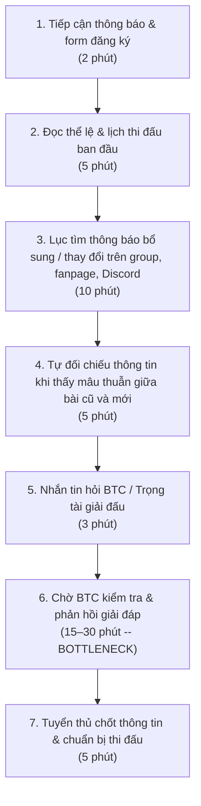
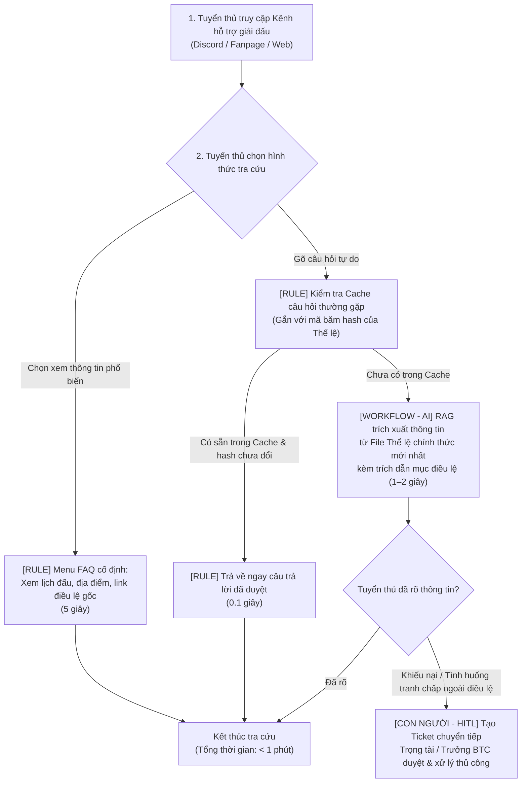

# Báo cáo nhóm — Day 02 Discovery & Problem Framing

> Bản chung của nhóm, viết trên repo do nhóm trưởng fork. Không copy file này sang repo cá nhân.
> Template chi tiết và prompt mẫu: [docs/01-worksheet.md](../../docs/01-worksheet.md). Bài mẫu: [docs/02-deliverable-example.md](../../docs/02-deliverable-example.md).

## 1. Thông tin nhóm

- Tên nhóm: NhomNhomNhom
- Thành viên: xem `TEAM.md`
- Candidate problem được chọn (1 câu): Người tham gia (tuyển thủ) khó tiếp cận thông tin chính xác, đầy đủ và cập nhật của các giải đấu Esports do CLB XayGame tổ chức.
- Quyết định cuối: Go / Not Yet / No-Go

---

## 2. Hội tụ nhóm (CP3)

### 2.1. Pitch

| # | Người đưa ra | Candidate (Job Story ngắn) | Actor | Bottleneck | Câu hỏi phản biện nhận được (ai hỏi) |
|---:|---|---|---|---|---|
| 1 | Bảo | Khi dự giải XAY MAJOR 2026, tôi muốn tra cứu nhanh lịch & thể lệ cập nhật, để không trễ giờ hay phạm quy. | Tuyển thủ giải XAY MAJOR; Trọng tài XayGame | Lội tin nhắn Zalo/Discord/Fanpage và chờ BTC giải đáp thủ công (20–45'). | Tuyển thủ thực sự thiếu thông tin hay thông tin bị trôi khó tìm? Trang Notion FAQ tập trung có đủ không? (Tân) |
| 2 | Bảo | Khi tổ chức sự kiện, tôi muốn nắm rõ kỹ năng & lịch rảnh của thành viên, để giao việc đúng người, tránh quá tải. | Ban Chủ nhiệm, Trưởng ban CLB XayGame | Rà soát thủ công kỹ năng và hỏi lịch rảnh từng người (mất 2–3 ngày). | Lịch rảnh sinh viên đổi liên tục, làm sao dữ liệu luôn đúng mà không tốn công cập nhật? (Hiệp) |
| 3 | Bảo | Khi thành viên nhận việc, tôi muốn theo dõi tiến độ & đóng góp công bằng, để kịp thời hỗ trợ và ghi nhận. | Ban Chủ nhiệm; thành viên thực hiện | Đối soát nguyên nhân chậm và họp đánh giá thủ công (mất nhiều buổi). | Mỗi ban tính chất việc rất khác nhau, dùng chung 1 khung đánh giá có bị bất công? (Đức) |
| 4 | Tân | Khi tìm phòng trọ mới, tôi muốn lọc tin thật quanh trường theo ngân sách, để hẹn xem phòng thật, tránh tin cò ảo. | Sinh viên đi thuê trọ | Nhắn tin hỏi chủ bài và chờ phản hồi để xác nhận tin thật (30'/buổi, >60% tin ảo). | Group Facebook chặn scraping, lấy bài thế nào? Cò mồi viết như người thật thì AI có lọc nhầm? (Bảo) |
| 5 | Tân | Khi cuối ngày chuẩn bị ngủ, tôi muốn gom chi tiêu lẻ từ 3 app ví/ngân hàng, để kiểm soát ngân sách không bị thâm hụt. | Sinh viên sống tự lập | Nhập tay từng khoản và nhớ lại mục đích chi tiêu (12'/tối, dễ bỏ dở). | Vấn đề bảo mật tài chính; người dùng có sẵn sàng cho app ngoài đọc biến động số dư? (Đức) |
| 6 | Tân | Khi nộp bài lab hàng tuần, tôi muốn soát đủ checklist quy cách nộp, để không bị trừ điểm oan vì lỗi hình thức. | Học viên thực hành AI | Dò thủ công từng tên file, xóa file rác (.DS_Store, cache) (10'/lần). | Bài này thuần rule, chỉ cần script bash/python regex là xong, có cần AI không? (Hiệp) |
| 7 | Đức | Khi sinh bài học từ tài liệu, tôi muốn biết dữ liệu có khớp yêu cầu môn/lớp không, để tránh tạo nội dung sai lệch. | Người soạn bài học trong hệ thống | Chưa phát hiện lệch dữ liệu trước khi sinh (vào Văn 8 yêu cầu Toán 9 vẫn sinh). | Chặn bằng rule chọn môn/lớp ở input đã đủ chưa, hay bắt buộc AI phải đọc hiểu ngữ nghĩa? (Tân) |
| 8 | Đức | Khi tích hợp code nhóm, tôi muốn thống nhất cách kết nối chức năng, để giảm xung đột và tránh sửa lại nhiều lần. | Thành viên đội dự án phần mềm | Tìm nguyên nhân xung đột và họp chốt yêu cầu (55–65'/lần). | Xung đột thường do chia module không rõ từ đầu, AI tóm tắt diff có giải quyết được gốc rễ? (Bảo) |
| 9 | Đức | Khi nộp bài tại trường, tôi muốn kiểm tra đủ các bước bắt buộc (cả link form xác nhận), để hoàn thành đúng hạn. | Học viên lab VinUni | Chưa đọc hết hướng dẫn PDF nên push code xong tưởng xong, suýt trễ hạn form. | Mới gặp 1 lần ở Day 01, một checklist ghi chú cá nhân (No AI) đã đủ triệt để chưa? (Hiệp) |
| 10 | Hiệp | Khi nhận đề lab dài nhiều file, tôi muốn nắm ngay tổng quan và việc cần làm, để bắt tay làm ngay, không mất công đọc mò. | Sinh viên nhận lab mới | Đọc từng file và xâu chuỗi yêu cầu nằm rải rác (20–25'/lần). | Dùng AI tóm tắt nhanh có nguy cơ bỏ sót lưu ý nhỏ/format ẩn dẫn đến mất điểm không? (Tân) |
| 11 | Hiệp | Khi có nhiều bài học và task mới mỗi ngày, tôi muốn biết thứ tự ưu tiên việc cần làm, để kịp deadline không bị quá tải. | Sinh viên tự quản lý việc học | Đắn đo chọn thứ tự học/làm ngẫu hứng đầu ngày (20–30', dễ phân tâm). | Thứ tự ưu tiên thay đổi theo cảm xúc và sự cố trong ngày, AI có đủ ngữ cảnh để xếp thay? (Đức) |
| 12 | Hiệp | Khi nhóm đã chia việc và thông báo lịch, tôi muốn thành viên tự nắm phần việc, để không hỏi lại làm ngắt quãng người khác. | Người điều phối nhóm học tập | Bị ngắt quãng việc đang làm để tra lại thông báo cũ trả lời tin nhắn (15–30'/đợt). | Nằm ở ý thức thành viên; nếu đã lười đọc tin nhắn ghim thì liệu họ có chịu tra cứu bot? (Bảo) |

### 2.2. Cluster

| Cluster | Các candidate | Pattern chung |
|---|---|---|
| **A — Tra cứu & tổng hợp thông tin phân tán** | **#1** (Bảo: Thông tin giải XAY MAJOR)<br>**#4** (Tân: Lọc tin phòng trọ)<br>**#10** (Hiệp: Đọc hiểu đề lab dài nhiều file) | Thông tin nằm rải rác ở nhiều nguồn/kênh khác nhau (tin nhắn mạng xã hội, kênh chat, nhiều file tài liệu); người dùng mất nhiều thời gian đọc mò, sàng lọc và xác thực thông tin nào là mới nhất và đúng nhất. |
| **B — Phối hợp, giao tiếp & vận hành nhóm** | **#2** (Bảo: Phân công việc CLB)<br>**#3** (Bảo: Theo dõi đánh giá việc CLB)<br>**#8** (Đức: Xung đột code khi tích hợp)<br>**#12** (Hiệp: Thành viên hỏi lại việc đã thông báo) | Quy trình làm việc giữa nhiều người; thiếu sự thống nhất về dữ liệu trạng thái, tiêu chí và ranh giới công việc, dẫn đến phải trao đổi qua lại lòng vòng, làm gián đoạn người khác và chậm tiến độ chung. |
| **C — Kiểm tra quy chuẩn & đối soát cá nhân** | **#5** (Tân: Gom chi tiêu lẻ từ 3 app)<br>**#6** (Tân: Checklist nộp bài lab)<br>**#7** (Đức: Lệch dữ liệu sinh bài học)<br>**#9** (Đức: Bỏ sót bước nộp form)<br>**#11** (Hiệp: Sắp xếp thứ tự ưu tiên việc) | Kiểm tra đầu vào/sản phẩm có tuân thủ đúng quy tắc, định dạng bắt buộc hay không trước khi nộp/xử lý tiếp, hoặc đối soát các mảnh dữ liệu/đầu việc hàng ngày để tránh sai sót. |

### 2.3. Opportunity Solution Tree rút gọn

Gốc là **1 outcome**. Nhánh là **opportunity** (nhu cầu, pain), không phải tính năng hay công cụ.

```text
OUTCOME: Giảm thời gian tuyển thủ tìm đúng thông tin và giảm câu hỏi lặp lại gửi về BTC giải XAY MAJOR 2026
├── Opportunity A: Thông tin giải đấu phân tán ở nhiều kênh (Fanpage, Zalo, Discord), dễ bị trôi và khó tìm lại
├── Opportunity B: Tuyển thủ không biết thông báo đang đọc có phải là bản cập nhật mới nhất hay không
└── Opportunity C: BTC mất nhiều thời gian trực tin nhắn trả lời lặp lại các câu hỏi đã có trong điều lệ
     ✗ "Chatbot AI tự trả lời mọi câu hỏi"  ← solution, gạch bỏ
     ✗ "App di động riêng cho giải đấu"     ← solution, gạch bỏ
```

Những ý đã gạch bỏ vì là solution đội lốt opportunity:

- **"Chatbot AI tự trả lời mọi câu hỏi"**: Đây là công cụ/giải pháp cụ thể, chưa xét đến việc liệu chỉ cần trang FAQ tập trung là đã đủ hay chưa.
- **"App di động riêng cho giải đấu"**: Đây là tính năng sản phẩm, không phải nỗi đau của người dùng.

### 2.4. Chấm điểm shortlist (1–5)

| Candidate | Actor rõ | Quy trình rõ | Pain có bằng chứng | Impact đo được | Vừa sức lab | So sánh được No AI/Rule/Workflow/Agent | Nhóm hiểu domain | Tổng |
|---|---:|---:|---:|---:|---:|---:|---:|---:|
| **#1 — Tiếp cận thông tin giải đấu XAY MAJOR** | 5 | 5 | 5 | 4 | 5 | 5 | 5 | 34 |
| #10 — Đọc hiểu & tổng hợp đề lab nhiều file | 5 | 5 | 4 | 4 | 4 | 3 | 4 | 29 |
| #4 — Lọc tin phòng trọ tránh tin ảo | 4 | 4 | 4 | 4 | 3 | 4 | 4 | 27 |

**Candidate được chọn:**
**#1 — Tuyển thủ khó tiếp cận thông tin chính xác, đầy đủ và cập nhật của giải đấu Esports (XAY MAJOR 2026).**

**Vì sao chọn:**
- **Hiểu rõ domain & có sẵn dữ liệu:** Thành viên nhóm (Bảo) trực tiếp thuộc BTC CLB XayGame, nắm rõ quy trình tổ chức giải và có thể tiếp cận ngay tuyển thủ/trọng tài để phỏng vấn, khảo sát.
- **So sánh tốt 4 mức can thiệp:** Dễ dàng đặt lên bàn cân giữa trang FAQ tập trung (No AI), bot từ khóa (Rule) và trợ lý trích xuất tài liệu chính thức có dẫn nguồn (Workflow).

**Vì sao loại các candidate còn lại:**
- **#10 (Đọc hiểu đề lab nhiều file):** Cấu trúc đề bài mỗi môn rất khác nhau; chỉ cần dùng mẫu note cố định (No AI) là đã giải quyết được phần lớn mà chưa cần quy trình phức tạp.
- **#4 (Lọc tin phòng trọ):** Dữ liệu các hội nhóm Facebook bị chặn cào (scraping) và biến động liên tục, vượt quá phạm vi kiểm chứng trong một buổi lab.

**Xử lý bất đồng (nếu có):**
- **Tân & Hiệp** cho rằng tuyển thủ chỉ "lười đọc", chỉ cần trang FAQ tĩnh (No AI) là đủ.
- **Đức** muốn chọn bài #7 và lo ngại bài #1 dễ bị AI trả lời nhầm lịch/thể lệ cũ đã hết hiệu lực.
- **Hướng thống nhất:** Chọn #1 vì dễ khảo sát người dùng thật trong buổi lab hơn #7; đồng thời đưa cả hai lo ngại về "FAQ tĩnh có đủ không" và "rủi ro dùng thông tin cũ" vào **Assumption Map (CP4)** và **Boundary (CP5)** để kiểm chứng.

---

## 3. Kiểm chứng + research giải pháp đã có (CP4)

### 3.1. Assumption Map

Thang điểm: 1 = thấp, 5 = cao. Điểm bằng chứng dựa trên thông tin đã xác nhận, không tính các tình huống minh họa tại mục 3.2.

| # | Giả định | Loại (Value / Usability / Feasibility / Viability) | Quan trọng (1–5) | Đã có bằng chứng (1–5) | Kiểm chứng trước? |
|---:|---|---|---:|---:|---|
| 1 | Tuyển thủ phải tìm hoặc đối chiếu nhiều thông báo để xác định thông tin mới nhất. | Value | 5 | 2 | Có |
| 2 | Việc tìm thông tin và chờ BTC phản hồi ảnh hưởng đến quá trình chuẩn bị tham gia. | Value | 5 | 1 | Có |
| 3 | Một trang thông tin tập trung và FAQ có thể giúp tuyển thủ tự tìm câu trả lời. | Usability | 5 | 1 | Có |
| 4 | BTC có thể cung cấp nguồn chính thức và duy trì cập nhật khi có thay đổi. | Feasibility | 5 | 1 | Có |
| 5 | Hỏi đáp bằng ngôn ngữ tự nhiên mang lại lợi ích hơn tìm kiếm và FAQ thông thường. | Value | 4 | 1 | Sau khi thử phương án không AI |
| 6 | BTC có đủ người phụ trách cập nhật, kiểm tra và xử lý câu hỏi chưa có đáp án. | Viability | 4 | 1 | Có |

**Giả định nhóm ưu tiên kiểm chứng:** Giả định 1–4, nhằm xác định khó khăn nằm ở việc tìm nguồn, hiểu thông báo, nhận cập nhật hay chờ BTC phản hồi.

### 3.2. Kiểm chứng

**Cách đã dùng:** Rà soát tài liệu công khai về giải đấu. Chưa có kết quả phỏng vấn hoặc survey được xác nhận.

> P01–P03 dưới đây là tình huống minh họa do AI hỗ trợ xây dựng. Các câu nói và thời gian không phải dữ liệu phỏng vấn thực tế.

#### Interview Snapshot P01 — Minh họa

| Trường | Nội dung |
|---|---|
| Người được hỏi (vai trò, không ghi tên thật) | Vai trò giả định: tuyển thủ TFT lần đầu tham gia giải. |
| Câu nói đáng nhớ nhất (nguyên văn) | Chưa có lời trích thực tế. Câu minh họa: “Tôi thấy giờ thi đấu rồi, nhưng chưa rõ phải có mặt trước bao lâu để check-in.” |
| Lần gần nhất gặp vấn đề này: chuyện gì đã xảy ra? | Tình huống giả định: sau khi đăng ký, người chơi quay lại tìm giờ có mặt. Bài giới thiệu có giờ thi đấu nhưng người chơi chưa xác định được giờ check-in. |
| Hiện đang xử lý bằng cách nào (workaround)? | Đọc lại bài đăng và form, sau đó nhắn BTC để xác nhận. |
| Mất bao lâu, bao lần? | Giả định: 5 phút tìm kiếm và 15 phút chờ phản hồi trong một tình huống. |
| Insight / opportunity rút ra | Giả thuyết cần kiểm tra: người chơi cần phân biệt rõ giờ check-in và giờ bắt đầu thi đấu. |

#### Interview Snapshot P02 — Minh họa

| Trường | Nội dung |
|---|---|
| Người được hỏi (vai trò, không ghi tên thật) | Vai trò giả định: tuyển thủ từng tham gia giải cộng đồng. |
| Câu nói đáng nhớ nhất (nguyên văn) | Chưa có lời trích thực tế. Câu minh họa: “Tôi thấy hai giờ khác nhau nên phải hỏi lại lịch nào đang áp dụng.” |
| Lần gần nhất gặp vấn đề này: chuyện gì đã xảy ra? | Tình huống giả định: người chơi xem ảnh lịch đã lưu, sau đó gặp thông báo mới có thời gian khác và cần xác nhận bản có hiệu lực. |
| Hiện đang xử lý bằng cách nào (workaround)? | Đọc tin nhắn gần nhất, hỏi người phụ trách và lưu thông báo mới. |
| Mất bao lâu, bao lần? | Giả định: 5 phút đối chiếu và 10 phút chờ xác nhận trong một tình huống. |
| Insight / opportunity rút ra | Giả thuyết cần kiểm tra: người chơi cần nhận biết phiên bản thông báo, thời điểm cập nhật và trạng thái hiệu lực. |

#### Interview Snapshot P03 — Minh họa

| Trường | Nội dung |
|---|---|
| Người được hỏi (vai trò, không ghi tên thật) | Vai trò giả định: thành viên BTC hỗ trợ tuyển thủ. |
| Câu nói đáng nhớ nhất (nguyên văn) | Chưa có lời trích thực tế. Câu minh họa: “Có thông tin trong hướng dẫn rồi, nhưng một số bạn chỉ xem ảnh giới thiệu hoặc link form.” |
| Lần gần nhất gặp vấn đề này: chuyện gì đã xảy ra? | Tình huống giả định: BTC nhận câu hỏi về giờ có mặt, địa chỉ thi đấu và điều kiện đăng ký dù đã có hướng dẫn. |
| Hiện đang xử lý bằng cách nào (workaround)? | Gửi lại link hướng dẫn hoặc câu trả lời có sẵn; chuyển trường hợp đặc biệt cho người phụ trách. |
| Mất bao lâu, bao lần? | Giả định: 1–2 phút xử lý một câu hỏi quen thuộc; chưa xác định số câu hỏi mỗi giải. |
| Insight / opportunity rút ra | Giả thuyết cần kiểm tra: cần cải thiện đường dẫn đến hướng dẫn và cách trình bày trước khi bổ sung công cụ mới. |

**Tổng hợp:**

| Nguồn | Số người / số mẫu | Tín hiệu xác nhận | Tín hiệu phản bác |
|---|---:|---|---|
| Bài VNGGames ngày 18/09/2025 | 1 bài công khai | Liệt kê “ĐH XÂY DỰNG HÀ NỘI – XAYGAME” trong nhóm giải Campus TFT, khu vực Hà Nội; xác nhận bối cảnh giải đấu có thật. | Không cung cấp bằng chứng tuyển thủ gặp khó hoặc cần AI. |
| P01–P03 | 0 người được xác nhận phỏng vấn; 3 tình huống minh họa | Chưa có tín hiệu xác nhận thực tế. Các tình huống giúp xác định câu hỏi cần kiểm tra. | Các khả năng cần kiểm tra gồm: thông báo được ghim có thể đã đủ; người chơi có thể chưa đọc hướng dẫn thay vì thiếu thông tin. |

**Nhóm đã sửa problem thế nào sau kiểm chứng:**

Qua rà soát tài liệu công khai, nhóm xác nhận được bối cảnh giải đấu gắn với XayGame nhưng chưa xác nhận nguyên nhân hoặc mức độ khó khăn của tuyển thủ.

Nhóm điều chỉnh hướng kiểm chứng từ nhận định chung “khó tiếp cận thông tin” sang việc tìm hiểu khả năng **tìm đúng nguồn và xác định thông báo đang có hiệu lực**. Cần phân biệt ba nguyên nhân: thông tin chưa rõ, cập nhật chưa đồng bộ và người tham gia chưa đọc hướng dẫn.

Đây là điều chỉnh phạm vi nghiên cứu, chưa phải kết luận từ phỏng vấn. Thời gian tìm thông tin, thời gian chờ BTC và số câu hỏi lặp lại vẫn chưa đo.

### 3.3. Research giải pháp đã có

Các tính năng được tham khảo từ tài liệu công khai. Khoảng trống và bài học là nhận định của nhóm, chưa phải kết quả triển khai thử với XayGame.

| Công cụ / case / pattern | Link | Giải bước nào trong quy trình? | Điểm mạnh | Khoảng trống / rủi ro | Bài học cho nhóm |
|---|---|---|---|---|---|
| Trang thông tin tập trung bằng Notion Sites | [Tài liệu chính thức](https://www.notion.com/help/public-pages-and-web-publishing) | Đọc và tra cứu thông tin giải. | Xuất bản trang ra web; có thể tổ chức lịch, địa điểm, thể lệ và FAQ trên một địa chỉ. | Vẫn cần BTC duy trì cập nhật; người chơi có thể không nhận ra thay đổi. | Thử một nguồn chính thức, ghi thời điểm cập nhật và người phụ trách. |
| Discord Forum Channels | [Tài liệu chính thức](https://support.discord.com/hc/en-us/articles/6208479917079-Forum-Channels-FAQ) | Tìm thông báo và câu trả lời theo chủ đề. | Có bài theo chủ đề, tag, tìm kiếm và lọc. | Cần Community server; chưa xác định mức độ sử dụng Discord của tuyển thủ XayGame. | Tổ chức chủ đề rõ ràng và kiểm tra khả năng tìm kiếm trước khi dùng AI. |
| start.gg — dữ liệu theo giải/event | [Tài liệu Get Event](https://developer.start.gg/docs/examples/queries/get-event/) | Xác định đúng nội dung thi đấu khi truy xuất dữ liệu. | Event có ID và tên, hỗ trợ truy vấn tiếp thông tin liên quan. | Chưa kiểm chứng khả năng đáp ứng toàn bộ thông báo và FAQ riêng của XayGame. | Dữ liệu phải gắn đúng giải, bộ môn và phiên bản để tránh trả nhầm. |

**Nguồn xác nhận bối cảnh:** [VNGGames — Tổng hợp giải ĐTCL từ ngày 18–28/09/2025](https://community.vnggames.com/news/tft/dtcl-vdqg-tong-hop-giai-dau-vo-dich-quoc-gia-t-ngay-18-09-28-09-2025.html).

**Kết luận research:**

Đã có các phương án tổ chức và tra cứu thông tin không cần AI. Nhóm nên so sánh một trang thông tin chính thức và FAQ với phương án hỏi đáp trước khi chọn mức can thiệp.

Nếu thử AI, hệ thống chỉ trả lời từ nguồn BTC đã xác nhận, dẫn nguồn và chuyển cho BTC xử lý khi thiếu hoặc mâu thuẫn dữ liệu. AI không tự thay đổi lịch, thể lệ hoặc quyết định điều kiện tham gia.

---

## 4. Quy trình trước/sau (CP5)

### 4.1. Quy trình hiện tại



| Bước | Actor | Input | Output | Thời gian / tần suất | Ghi chú |
|---:|---|---|---|---|---|
| 1 | Tuyển thủ | Bài đăng fanpage, thông báo Discord | Nắm được giải đấu và link form đăng ký | 2 phút / 1 lần đầu giải | Nguồn tin ban đầu thường phân tán qua nhiều kênh |
| 2 | Tuyển thủ | File PDF điều lệ, bài đăng thể thức | Nắm khung lịch thi đấu và luật chung | 5 phút / 1–2 lần | Đọc lướt, chưa nhớ hết các điều khoản chi tiết |
| 3 | Tuyển thủ | Kênh chat Discord, bài đính chính trên group | Tìm kiếm thông báo mới nhất khi có thay đổi | 10 phút / 2–3 lần mỗi giai đoạn giải | Thông báo trôi trong kênh chat, khó biết bản nào là mới nhất |
| 4 | Tuyển thủ | Các bài đăng cũ và mới | Phát hiện mâu thuẫn hoặc chưa rõ quy định | 5 phút / mỗi khi có thắc mắc | Hoang mang không biết áp dụng theo quy định nào |
| 5 | Tuyển thủ | Câu hỏi thắc mắc của đội | Tin nhắn gửi về Fanpage/Discord BTC | 3 phút / 1–2 lần mỗi đội | Thường hỏi dồn dập vào sát giờ thi đấu hoặc giờ check-in |
| 6 | Tuyển thủ & BTC | Tin nhắn hỏi của tuyển thủ | Câu trả lời xác nhận từ BTC/Trọng tài | 15–30 phút (BOTTLENECK) | BTC bị quá tải câu hỏi lặp lại; tuyển thủ phải chờ đợi sốt ruột |
| 7 | Tuyển thủ | Câu trả lời đã xác nhận | Kế hoạch tham gia, check-in đúng giờ | 5 phút | Hoàn tất chuẩn bị |

**Bottleneck chính:**
Bước 5 và 6 — Khâu nhắn tin hỏi BTC và chờ BTC đối chiếu trả lời (mất 15–30 phút/lần, cá biệt sát giờ thi đấu có thể lâu hơn do BTC quá tải). Tuyển thủ bị động, lo lắng bị xử thua do trễ giờ check-in hoặc vi phạm thể lệ; BTC mất nhiều nhân lực trả lời đi trả lời lại các câu hỏi đã có trong văn bản.

### 4.2. Quy trình tương lai



**Quy định các bước và phân định công nghệ:**
- **`[RULE]` (Bước 2, Bước 3):**
  - Cung cấp Menu FAQ cố định (các nút bấm chọn nhanh: Lịch thi đấu hôm nay, Danh sách bảng đấu, Link Rulebook gốc, Quy định check-in).
  - Tự động kiểm tra Semantic Cache: Nếu câu hỏi đã có người hỏi và mã băm (`doc_hash`) của tài liệu Thể lệ chưa thay đổi $\rightarrow$ lấy câu trả lời từ Cache trả về tức thì (0.1s), không tốn chi phí gọi AI.
  - Khi BTC cập nhật Thể lệ $\rightarrow$ mã băm thay đổi $\rightarrow$ tự động xóa Cache cũ để tránh trả lời nhầm luật cũ.
- **`[WORKFLOW - AI]` (Bước 4):**
  - Khi câu hỏi chưa có trong Cache, AI (RAG) chỉ đọc dữ liệu từ **File Thể lệ chính thức mới nhất** được BTC xác nhận để trả lời ngắn gọn, đúng trọng tâm và **bắt buộc đính kèm nguồn** (ví dụ: *"Theo Mục 3.2 - Thể lệ XAY MAJOR 2026..."*).
- **`[CON NGƯỜI - HITL]` (Bước 5):**
  - Trọng tài/BTC luôn giữ quyền kiểm soát tối cao. Với các câu hỏi khiếu nại kết quả, tố cáo gian lận, đổi người ngoài quy định, hệ thống tự động gắn cờ (flag) và chuyển tiếp cho Trọng tài giải quyết thủ công.

**BOUNDARY (Ranh giới an toàn của AI):**
- AI **tuyệt đối KHÔNG** tự ý đưa ra phán quyết xử thua, xử phạt, hủy kết quả trận đấu hoặc giải quyết các tranh chấp giữa các đội (các việc này 100% thuộc thẩm quyền của Trọng tài/BTC).
- AI **tuyệt đối KHÔNG** tự suy diễn hay bịa đặt luật ngoài văn bản Điều lệ chính thức; nếu không tìm thấy trong tài liệu, AI phải nói rõ *"Thông tin này chưa có trong Điều lệ, đang chuyển cho BTC hỗ trợ"*.
- AI **tuyệt đối KHÔNG** sử dụng dữ liệu từ các thông báo cũ đã hết hiệu lực.

**PHƯƠNG ÁN QUAY VỀ (Fallback khi AI gặp sự cố):**
- Nếu hệ thống AI bị lỗi kết nối, quá tải API hoặc gặp sự cố kỹ thuật: Hệ thống tự động chuyển về chế độ cơ bản (fallback), hiển thị trực tiếp link Google Docs/Notion của Trang Thể lệ chính thức và mở ngay luồng chat trực tiếp với Trọng tài trực ban để hỗ trợ thủ công như quy trình cũ.

### 4.3. Before / after

| Chỉ số | Trước (Hiện tại) | Sau (Kỳ vọng) | Ghi chú |
|---|---:|---:|---|
| **Số bước** | 7 bước | 3–4 bước | Rút ngắn đáng kể các bước tìm kiếm và chờ đợi |
| **Tổng thời gian** | 40–55 phút/lần | Dưới 2 phút/lần | Với câu hỏi có sẵn FAQ/Cache: chỉ mất 5–10 giây |
| **Số bước thủ công** | 6/7 bước thủ công | 1 bước thủ công | BTC chỉ phải can thiệp thủ công ở các ca khiếu nại đặc biệt |
| **Bottleneck chính** | Chờ BTC trả lời tin nhắn (15–30') | Chuyển sang khâu tuyển thủ đọc & xác nhận lại | Điểm nghẽn mới nằm ở người dùng kiểm tra lại thông tin, hoàn toàn chấp nhận được |
| **Rủi ro mới phát sinh** | — | AI trả lời nhầm nếu câu hỏi diễn đạt mơ hồ; tuyển thủ phụ thuộc hoàn toàn vào AI | Khắc phục bằng: Bắt buộc AI trích dẫn nguồn điều lệ + Nút bấm gọi Trọng tài hỗ trợ |

---

## 5. Problem Statement v0 (CP5)

| Trường | Nội dung |
|---|---|
| **Actor** | Tuyển thủ tham gia các giải đấu Esports do CLB XayGame tổ chức (Bên liên quan trực tiếp: Ban tổ chức giải và Đội ngũ trọng tài). |
| **Quy trình** | Khi tham gia giải đấu, tuyển thủ tiếp cận bài đăng, đọc điều lệ ban đầu, tìm kiếm các thông báo cập nhật, đối chiếu khi có thay đổi, nhắn tin hỏi BTC các điểm chưa rõ và chờ phản hồi để hoàn tất khâu chuẩn bị thi đấu. |
| **Bottleneck** | Khâu tìm kiếm thông báo cập nhật bị phân tán và thời gian chờ BTC phản hồi giải đáp thắc mắc (mất từ 15–30 phút/lần, đặc biệt nghẽn nghiêm trọng vào khung giờ check-in sát trận đấu). |
| **Impact** | Tuyển thủ có nguy cơ hiểu nhầm lịch đấu, địa điểm hoặc quy trình check-in dẫn đến bị xử thua hoặc trễ giờ thi đấu; BTC mất nhiều nguồn lực trả lời lặp đi lặp lại hàng chục câu hỏi giống nhau, làm chậm tiến độ điều phối chung của giải. |
| **Success Metric** | - **Baseline (Hiện tại):** Thời gian trung bình để tuyển thủ tìm và xác nhận thông tin là 40–55 phút/lần; số câu hỏi lặp lại gửi về BTC trong mỗi giải đấu là khoảng 40–50 câu (ước lượng qua giải gần nhất).<br>- **Target (Mục tiêu):** Thời gian tuyển thủ tìm đúng thông tin giảm xuống dưới 2 phút/lần; số lượng câu hỏi lặp lại gửi về BTC giảm ít nhất 70% (xuống dưới 15 câu/giải).<br>- **Cách đo:** Bấm giờ thử nghiệm hành vi tra cứu của tuyển thủ và thống kê số lượng tin nhắn hỏi lặp lại gửi về kênh hỗ trợ của BTC trong giải đấu tiếp theo của CLB. |
| **Boundary** | AI không được tự ý quyết định các vấn đề tranh chấp, khiếu nại hay xử phạt thay trọng tài; AI không được tự bịa thông tin ngoài tài liệu chính thức; luôn có nút chuyển tiếp cho con người (HITL) khi có tình huống phát sinh ngoài điều lệ. |

**Phản biện nhận được (từ AI và thảo luận nhóm) và cách xử lý:**
- *Phản biện 1:* Success Metric ban đầu chỉ đo thời gian mà chưa đo độ chính xác; nếu AI trả lời nhanh nhưng trích dẫn nhầm lịch đấu cũ thì hậu quả xử thua còn nặng nề hơn. $\rightarrow$ **Nhóm đồng ý:** Đã bổ sung yêu cầu bắt buộc AI phải trích dẫn số hiệu mục điều lệ và đính kèm cơ chế kiểm tra mã băm hash của văn bản để đảm bảo chỉ dùng bản mới nhất.
- *Phản biện 2:* Có cần thiết phải làm một chatbot AI phức tạp không khi mà một trang FAQ tập trung (Notion/Google Docs) đã có thể giải quyết được 70% vấn đề? $\rightarrow$ **Nhóm đồng ý một phần:** Nhóm thiết kế giải pháp phân tầng, đưa Menu FAQ cố định lên đầu (Rule/No AI), chỉ dùng AI để giải quyết các câu hỏi tra cứu tình huống cụ thể trong điều lệ dài.

---

## 6. Mức can thiệp AI (CP6)

### 6.1. Ma trận độ mơ hồ × độ phức tạp

Bài của nhóm nằm ở ô:

Vì sao:

### 6.2. So sánh 4 mức

| Mức | Phương án cho bài của nhóm | Đủ khi nào | Rủi ro | Chọn? |
|---|---|---|---|---|
| **No AI** (sửa quy trình) | | | | |
| **Rule** | | | | |
| **Workflow** | | | | |
| **Agent** | | | | |

**Mức chọn:**

**Vì sao không chọn mức đơn giản hơn:**

### 6.3. AI Canvas rút gọn

| Thành phần | Nội dung |
|---|---|
| **Prediction** — AI dự đoán / tạo ra gì? | |
| **Judgment** — con người cân nhắc, quyết định gì? | |
| **Action** — hành động cuối cùng là gì, ai làm? | |
| **Outcome** — đo kết quả bằng gì? | |
| **Input** — AI cần dữ liệu đầu vào gì mỗi lần chạy? Có sẵn không? | |
| **Feedback** — lấy phản hồi ở đâu để cải thiện? | |

### 6.4. Hai câu hỏi của Google PAIR

- Người dùng muốn **được hỗ trợ (augment)** hay **giao hẳn việc (automate)**? Bằng chứng:
- AI sai kiểu nào tệ hơn, **báo nhầm** hay **bỏ sót**? Vì sao, và thiết kế đã xử lý thế nào:

---

## 7. Problem Statement v1 + tiêu chí đánh giá (CP6)

| Trường | Nội dung |
|---|---|
| **Actor** | |
| **Quy trình** | |
| **Bottleneck** | |
| **Impact** | |
| **Success Metric** (baseline → target, cách đo) | |
| **Boundary** | |
| **AI intervention point** | |
| **Mức chọn** | No AI / Rule / Workflow / Agent |
| **Rủi ro & người kiểm tra** | |

**Thay đổi so với v0 và lý do:**

| Trường | v0 | v1 | Vì sao đổi |
|---|---|---|---|
| | | | |

**Tiêu chí đánh giá đầu ra của AI (3–5 tiêu chí):**

| # | Tiêu chí | Đạt khi | Không đạt khi |
|---:|---|---|---|
| 1 | | | |
| 2 | | | |
| 3 | | | |

---

## 8. Quyết định (CP6)

### 8.1. Bốn rủi ro

| Rủi ro | Câu hỏi | Mức độ rủi ro (Thấp = an toàn / TB / Cao = nguy hiểm) | Lý do / bằng chứng |
|---|---|---|---|
| **Value** | Người dùng có thật sự cần và sẽ dùng không? | | |
| **Usability** | Người dùng có dùng được, có hiểu và sửa được đầu ra của AI không? | | |
| **Feasibility** | Có đủ dữ liệu, công cụ, kỹ năng để làm không? | | |
| **Viability** | Có hợp chi phí, pháp lý, quy định tổ chức không? Ai vận hành? | | |

### 8.2. Kết luận

**Quyết định:** Go / Not Yet / No-Go

**Lý do:**

**Nếu Go — pilot nhỏ nhất:**

**Nếu Not Yet — cần kiểm chứng gì trước:**

**Nếu No-Go — nên làm gì thay AI:**

**Ngưỡng dừng** (nếu sau … mà … thì quay về …):

---

## 9. Hạn chế và hướng tiếp theo

-

## 10. Tài liệu tham khảo

-
