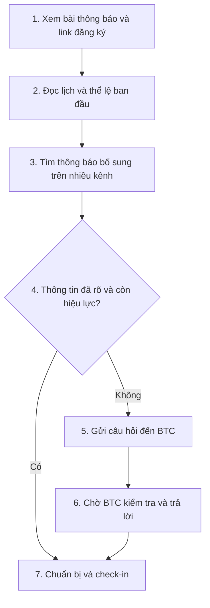
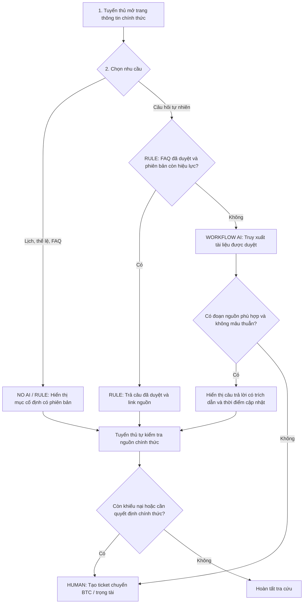

# Báo cáo nhóm — Day 02: Discovery & Problem Framing

> **Nhóm:** NhomNhomNhom · **Lớp:** K5-L3A · **Đề tài:** Tra cứu thông tin giải đấu XayGame  
> **Nguồn tổng hợp:** `TEAM.md`, 4 báo cáo cá nhân và `report/team/group_report.md` trên nhánh `main` (đọc ngày 10/11/2026).  
> **Quy ước:** **Quan sát** = trải nghiệm được thành viên ghi nhận; **Ước lượng** = con số chưa có log đo; **Mục tiêu** = ngưỡng mong muốn; **Chưa kiểm chứng** = chưa có khảo sát/phỏng vấn xác thực. Các đề xuất CP6 bên dưới cần được nhóm phê duyệt trước khi coi là quyết định đã thống nhất.

## 1. Thông tin nhóm

| Thành viên | MSSV | Vai trò theo TEAM.md |
|---|---|---|
| Tống Thiên Bảo | 2A202603461 | Trưởng nhóm, domain owner; phụ trách CP6 và tham gia CP3–CP4 |
| Nguyễn Quang Hiệp | 2A202603509 | CP5: workflow trước/sau, Problem Statement v0 |
| Dương Minh Tân | 2A202603464 | CP3: cluster, Opportunity Solution Tree, chấm điểm |
| Lưu Văn Việt Đức | 2A202603445 | CP4: kiểm chứng, research |

**Candidate problem:** Khi chuẩn bị và tham gia giải Esports do CLB XayGame tổ chức, tuyển thủ muốn tìm nhanh được lịch thi đấu, địa điểm, thể lệ và các thay đổi **đúng phiên bản, còn hiệu lực**, để chủ động chuẩn bị và tránh bỏ lỡ thông báo quan trọng.

**Định hướng quyết định:** `TEAM.md` hiện ghi **Go**. Bản tổng hợp này diễn giải thận trọng thành **Go có điều kiện đối với pilot nội bộ giới hạn**, không phải Go triển khai rộng. Do CP4 chưa có phỏng vấn hoặc số đo thực nghiệm được xác nhận, mức rủi ro Value/Usability thực tế vẫn cần kiểm chứng. Nếu rubric yêu cầu Go chỉ khi không có rủi ro Cao, nhóm cần xác nhận lại quyết định, có thể chuyển thành **Not Yet** cho triển khai AI chính thức.

---

## 2. Hội tụ nhóm (CP3)

### 2.1. Pitch — 12 candidate

| # | Người | Candidate ngắn | Actor | Bottleneck | Câu hỏi phản biện trong bản nhóm hiện hành |
|---:|---|---|---|---|---|
| 1 | Bảo | Tìm lịch, địa điểm và điều lệ mới nhất của XAY MAJOR | Tuyển thủ, trọng tài | Thông tin phân tán; hỏi BTC để xác nhận | Thiếu thông tin hay khó tìm; FAQ có đủ? (Tân) |
| 2 | Bảo | Giao nhiệm vụ CLB theo năng lực và lịch rảnh | Ban chủ nhiệm, trưởng ban | Hỏi từng thành viên, rà soát thủ công | Lịch rảnh biến động, cập nhật thế nào? (Hiệp) |
| 3 | Bảo | Theo dõi tiến độ và đánh giá công bằng | Quản lý và thành viên CLB | Đối soát nguyên nhân chậm, đánh giá thủ công | Một khung chung có công bằng giữa các ban? (Đức) |
| 4 | Tân | Lọc tin phòng trọ thật, đúng ngân sách | Sinh viên thuê trọ | Xác minh tin và chủ đăng | Hạn chế dữ liệu Facebook; nguy cơ lọc nhầm? (Bảo) |
| 5 | Tân | Tổng hợp chi tiêu nhiều ứng dụng | Sinh viên tự lập | Nhập lại khoản chi và phân loại | Bảo mật dữ liệu tài chính? (Đức) |
| 6 | Tân | Soát checklist nộp bài lab | Học viên | Kiểm tra thủ công tên file, quy cách | Rule/script đủ chưa? (Hiệp) |
| 7 | Đức | Kiểm tra dữ liệu đầu vào có khớp yêu cầu sinh bài học | Người soạn bài học | Không chặn yêu cầu lệch môn/lớp | Rule chọn môn/lớp đã đủ? (Tân) |
| 8 | Đức | Giảm xung đột khi tích hợp code nhóm | Nhóm phát triển | Phải dò xung đột và thống nhất yêu cầu | Gốc rễ có phải chia module chưa rõ? (Bảo) |
| 9 | Đức | Không bỏ sót bước xác nhận nộp bài | Học viên | Đọc thiếu hướng dẫn và link form | Checklist cá nhân đủ chưa? (Hiệp) |
| 10 | Hiệp | Đọc hiểu bài lab dài nhiều file | Sinh viên | Tìm, đối chiếu yêu cầu phân tán | AI tóm tắt có bỏ sót quy định? (Tân) |
| 11 | Hiệp | Ưu tiên lịch học và task | Sinh viên | Tự cân nhắc thứ tự công việc | AI có đủ ngữ cảnh biến động? (Đức) |
| 12 | Hiệp | Hạn chế thành viên hỏi lại thông báo nhóm | Người điều phối | Tra lại tin cũ, giải thích lặp lại | Nếu không đọc tin ghim, có tra bot không? (Bảo) |

*Lưu ý:* Bảng pitch và tên người phản biện được kế thừa từ `group_report.md` đang có; không có biên bản họp độc lập kèm theo để đối chiếu từng phát biểu.

### 2.2. Cluster

| Cluster | Candidate | Pattern chung |
|---|---|---|
| **A — Tra cứu, tổng hợp thông tin phân tán** | #1, #4, #10 | Nhiều nguồn, khó phân biệt nội dung đúng và mới nhất; mất thời gian tìm, đối chiếu |
| **B — Phối hợp và vận hành nhóm** | #2, #3, #8, #12 | Thiếu trạng thái thống nhất, handoff chưa rõ; phải trao đổi lại nhiều lần |
| **C — Kiểm tra quy chuẩn và đối soát cá nhân** | #5, #6, #7, #9, #11 | Cần kiểm tra ràng buộc, định dạng, dữ liệu và ưu tiên trước khi hành động |

### 2.3. Opportunity Solution Tree (OST) rút gọn

```text
OUTCOME: Giảm thời gian tuyển thủ tìm và xác nhận thông tin còn hiệu lực;
         giảm câu hỏi lặp lại gửi tới BTC
  ├─ Opportunity A: Không biết tìm thông báo chính thức ở đâu
  ├─ Opportunity B: Khó phân biệt bài cũ và bản cập nhật có hiệu lực
  └─ Opportunity C: Chờ BTC xác nhận câu hỏi lặp lại

  [KHÔNG phải opportunity] "Làm chatbot AI tự trả lời mọi câu hỏi"
  [KHÔNG phải opportunity] "Xây app riêng cho giải đấu"
```

Hai ý cuối là **giải pháp**, không phải nhu cầu của người dùng; vì vậy không được dùng làm gốc cây cơ hội.

### 2.4. Chấm điểm shortlist

Thang 1–5 trên mỗi tiêu chí: actor rõ, quy trình rõ, pain có bằng chứng, impact đo được, vừa sức lab, so sánh 4 mức can thiệp, hiểu domain.

| Candidate | Actor | Quy trình | Bằng chứng | Impact | Vừa sức | So sánh 4 mức | Domain | Tổng |
|---|---:|---:|---:|---:|---:|---:|---:|---:|
| **#1 — Thông tin giải XAY MAJOR** | 5 | 5 | 5 | 4 | 5 | 5 | 5 | **34** |
| #10 — Tóm tắt đề lab | 5 | 5 | 4 | 4 | 4 | 3 | 4 | 29 |
| #4 — Tin phòng trọ | 4 | 4 | 4 | 4 | 3 | 4 | 4 | 27 |

Điểm trên là **đánh giá nội bộ**, không phải số liệu khảo sát người dùng. Riêng mức 5/5 về bằng chứng cho #1 phản ánh việc có người trong nhóm trực tiếp hiểu bối cảnh BTC, **không có nghĩa đã xác minh được tần suất hay mức độ ảnh hưởng của pain**.

**Lý do chọn #1:** Actor và phạm vi sự kiện rõ; Bảo có kinh nghiệm thực tế từ XayGame; có thể tiếp cận thông báo, form, điều lệ, và nhóm tuyển thủ để đo thử; dễ so sánh FAQ (No AI), menu (Rule), hỏi đáp có nguồn (Workflow). Bài #10 có giải pháp mẫu ghi chú/checklist khá trực tiếp; bài #4 phụ thuộc dữ liệu bên ngoài khó xác minh và dễ phát sinh vấn đề quyền truy cập.

**Phản biện còn giữ:** Có thể không phải thiếu thông tin mà do đường dẫn khó tìm hoặc người tham gia không đọc thông báo; AI còn có nguy cơ trả nhầm lịch và thể lệ cũ. Đây là giả định phải kiểm chứng, không phải tranh luận đã được thực nghiệm giải quyết.

---

## 3. Kiểm chứng và research giải pháp đã có (CP4)

### 3.1. Assumption Map

Điểm bằng chứng 1–5 dưới đây là **mức đánh giá sơ bộ dựa trên nội dung hiện có**, không phải kết quả phỏng vấn.

| # | Giả định | Loại | Quan trọng | Bằng chứng | Kiểm chứng trước? |
|---:|---|---|---:|---:|---|
| 1 | Tuyển thủ phải tìm/đối chiếu nhiều thông báo | Value | 5 | 2 | Có |
| 2 | Tra cứu/chờ BTC ảnh hưởng chuẩn bị thi đấu | Value | 5 | 1 | Có |
| 3 | Trang thông tin tập trung + FAQ giúp người dùng tự tra cứu | Usability | 5 | 1 | Có |
| 4 | BTC duy trì được nguồn tài liệu chính thức, có version | Feasibility | 5 | 1 | Có |
| 5 | Hỏi tự nhiên có lợi ích tăng thêm so với FAQ | Value | 4 | 1 | Sau thử No AI |
| 6 | Có nhân sự cập nhật nguồn và tiếp nhận ca khó | Viability | 4 | 1 | Có |

### 3.2. Tình trạng kiểm chứng hiện tại

- **Đã có:** Quan sát từ người từng tham gia tổ chức giải XayGame; rà soát tài liệu công khai chứng minh bối cảnh hoạt động giải đấu.
- **Chưa có bằng chứng được xác nhận trong repo:** Transcript phỏng vấn tuyển thủ/trọng tài, khảo sát có mẫu thật, log câu hỏi gửi BTC, đo thời gian tìm thông tin.
- **P01–P03 trong báo cáo trước:** Là **tình huống minh họa do AI hỗ trợ dựng**, không phải lời nói hay dữ liệu của 3 người được phỏng vấn. Không tính vào sample size; hiện số interview được xác nhận là **0**.

| Tình huống để thiết kế câu hỏi phỏng vấn (không phải phỏng vấn thật) | Điều cần hỏi/đo |
|---|---|
| P01 — Người tham gia lần đầu không phân biệt giờ check-in và giờ đấu | Mất mấy phút tìm? Nguồn nào? Có gửi tin hỏi BTC? |
| P02 — Có thông báo giờ đấu bị thay đổi | Làm sao nhận ra bản còn hiệu lực? Có nhầm phiên bản không? |
| P03 — Thành viên BTC nhận câu hỏi lặp lại | Có bao nhiêu câu hỏi/giải? Có FAQ sẵn chưa? Bao lâu phản hồi? |

**Dấu hiệu phản bác cần chủ động tìm:** Phần lớn tuyển thủ tìm được câu trả lời trong 1–2 phút chỉ bằng thông báo ghim; không có lịch thay đổi; câu hỏi lặp lại rất ít; BTC không đủ nguồn lực cập nhật trang chính thức. Nếu vậy, vấn đề hoặc giải pháp cần thu hẹp.

**Kế hoạch kiểm chứng bổ sung:** Phỏng vấn độc lập 3 người có trải nghiệm thực tế (ưu tiên tuyển thủ và BTC ngoài nhóm), khảo sát 5–10 tuyển thủ nếu tiếp cận được; giao 5 nhiệm vụ tra cứu (lịch, giờ check-in, địa điểm, điều kiện đăng ký, thay đổi thể lệ), đo thời gian và độ chính xác; thống kê câu hỏi lặp lại đã được BTC xác nhận. Đây là **kế hoạch đề xuất**, chưa phải công việc đã hoàn thành.

### 3.3. Research giải pháp hiện có

| Giải pháp | Nguồn | Giải quyết bước nào | Điểm mạnh | Hạn chế / bài học |
|---|---|---|---|---|
| **Notion Sites** | [Notion — Public Pages](https://www.notion.com/help/public-pages-and-web-publishing) | Công bố một trang lịch, địa điểm, rulebook, FAQ | Nguồn truy cập tập trung, không cần AI | Phải quản lý cập nhật và dấu thời gian; chưa chứng minh người dùng sẽ đọc |
| **Discord Forum Channels** | [Discord — Forum Channels FAQ](https://support.discord.com/hc/en-us/articles/6208479917079-Forum-Channels-FAQ) | Tổ chức thông tin theo chủ đề/tag | Giảm trôi tin trong chat | Phụ thuộc việc tuyển thủ có dùng Discord và cách duy trì forum |
| **start.gg event data** | [start.gg — Get Event](https://developer.start.gg/docs/examples/queries/get-event/) | Truy xuất dữ liệu đúng event | Định danh sự kiện rõ ràng | Không thay thế được mọi thông báo/check-in và nội quy riêng của XayGame |

**Nguồn ngữ cảnh:** [VNGGames — Tổng hợp giải ĐTCL (18–28/09/2025)](https://community.vnggames.com/news/tft/dtcl-vdqg-tong-hop-giai-dau-vo-dich-quoc-gia-t-ngay-18-09-28-09-2025.html) — nguồn tham khảo về hoạt động giải đấu, **không chứng minh mức độ đau của người dùng**.

**Kết luận CP4:** Trước tiên cần chuẩn hóa **Single Source of Truth** (một nguồn nội dung chính thức), FAQ và thông báo phiên bản. Chỉ thí điểm AI nếu người dùng vẫn không thể tìm/hiểu đáp án cần thiết bằng các phương án đơn giản.

---

## 4. Quy trình trước/sau (CP5)

### 4.1. AS-IS — quy trình hiện tại



| Bước | Actor | Input → Output | Thời gian trong bản nháp CP5 | Trạng thái đo |
|---:|---|---|---|---|
| 1 | Tuyển thủ | Bài thông báo → link đăng ký | 2 phút | Ước lượng |
| 2 | Tuyển thủ | Điều lệ → hiểu lịch và luật | 5 phút | Ước lượng |
| 3 | Tuyển thủ | Fanpage/Discord/group → tìm bản cập nhật | 10 phút | Ước lượng |
| 4 | Tuyển thủ | Bản cũ/mới → đối chiếu | 5 phút | Ước lượng |
| 5 | Tuyển thủ | Thắc mắc → tin nhắn cho BTC | 3 phút | Ước lượng |
| 6 | BTC/trọng tài | Câu hỏi → phản hồi xác nhận | 15–30 phút | Ước lượng; bottleneck giả định |
| 7 | Tuyển thủ | Phản hồi → kế hoạch tham gia | 5 phút | Ước lượng |

**Bottleneck giả định:** Tìm đúng bản cập nhật (bước 3–4) và chờ BTC giải thích (bước 5–6). Các mốc trong bản trước chưa có log chứng minh; không ghi là thời gian trung bình đã đo.

### 4.2. TO-BE — quy trình tương lai phân tầng



**Phân vai:** (1) BTC duyệt và xuất bản thông tin gốc; (2) Rule/menu phục vụ tình huống phổ biến; (3) Workflow AI chỉ diễn giải phần có căn cứ trong nguồn chính thức; (4) BTC/trọng tài quyết định các trường hợp nhạy cảm hoặc thiếu dữ liệu. `doc_hash`/version chỉ giúp **phát hiện nguồn thay đổi và làm mất hiệu lực cache**, không tự chứng minh nguồn đó đã đúng; vẫn cần BTC xác nhận tài liệu hợp lệ.

**Fallback:** Khi AI lỗi, không có nguồn, hai nguồn mâu thuẫn, hoặc hệ thống chưa sẵn sàng, chỉ hiện FAQ/trang chính thức và mở kênh hỏi BTC. Không tự suy đoán câu trả lời.

### 4.3. Before/After — chỉ tiêu thiết kế, chưa phải kết quả đo

| Chỉ số | AS-IS trong bản nháp | TO-BE mục tiêu | Cách đo tương lai |
|---|---|---|---|
| Số thao tác | 7 bước trong kịch bản có hỏi BTC | 3–4 bước trong kịch bản tự phục vụ | Quan sát cùng một bộ nhiệm vụ |
| Thời gian xác nhận | 40–55 phút/lần (ước lượng cũ; tổng các bước nháp không hoàn toàn đồng nhất) | Dưới 2 phút với câu hỏi được hỗ trợ | Bấm giờ từ lúc nhận câu hỏi đến khi chọn đáp án đúng |
| Chờ BTC | 15–30 phút ở bước 6 (ước lượng) | Không cần với FAQ rõ ràng; ca khó vẫn chuyển người | Log thời gian phản hồi |
| Độ chính xác | Chưa đo | Không trả sai thông tin lịch/thể lệ có ảnh hưởng thi đấu | So với đáp án BTC duyệt |
| Câu hỏi lặp lại | 40–50 câu/giải (ước lượng trong v0, chưa có log) | Giảm ≥70% so với baseline đo lại | Đếm câu hỏi cùng chủ đề mỗi giải |

---

## 5. Problem Statement v0 (CP5)

| Trường | Nội dung kế thừa và chỉnh độ chắc chắn |
|---|---|
| **Actor** | Tuyển thủ tham gia giải Esports của XayGame; bên liên quan gồm BTC và trọng tài. |
| **Quy trình** | Xem thông báo → đọc điều lệ → tìm/đối chiếu thay đổi → hỏi BTC khi chưa rõ → chờ trả lời → chuẩn bị thi đấu. |
| **Bottleneck** | Khó biết bản lịch/thể lệ còn hiệu lực và có thể phải chờ BTC xác nhận ở bước 5–6. |
| **Impact** | Nguy cơ bỏ lỡ check-in, hiểu sai quy định, tốn thời gian chuẩn bị; BTC phải xử lý câu hỏi lặp lại. Mức độ thực tế chưa đo. |
| **Success Metric** | Baseline chưa có số đo đáng tin cậy; bản nháp có ước lượng 40–55 phút/lần, 40–50 câu hỏi lặp/giải. Mục tiêu thử nghiệm: tìm được thông tin đúng dưới 2 phút và giảm ít nhất 70% câu hỏi lặp so với baseline đo mới. |
| **Boundary** | AI không phân xử, xử phạt, sửa lịch hay điều lệ; không tạo luật mới; thiếu nguồn hoặc mâu thuẫn thì chuyển BTC/trọng tài. |

**Phản biện v0:** Chỉ đo tốc độ là chưa đủ vì trả lời sai có thể gây hại hơn chờ lâu. Cần thêm độ đúng, tính cập nhật và khả năng từ chối. Ngoài ra, cần thử FAQ trước khi chứng minh có nhu cầu cho AI.

---

## 6. Mức can thiệp AI (CP6)

### 6.1. Ma trận độ mơ hồ × độ phức tạp

**Vị trí đề xuất:** **Mơ hồ trung bình–cao × phức tạp trung bình** ở nhánh hỏi tự nhiên; **mơ hồ thấp × phức tạp thấp** ở các mục FAQ có cấu trúc.

- Lịch thi đấu, địa điểm, điều lệ có đáp án đúng/sai xác định nên **mơ hồ về sự thật thấp**; nhưng tuyển thủ có thể hỏi bằng tiếng Việt tự nhiên, thiếu bộ môn/vòng đấu hoặc có tình huống chưa ghi rõ nên **mơ hồ đầu vào cao hơn**.
- Nếu có nhiều loại tài liệu và phiên bản, quy trình cần chọn đúng sự kiện, truy xuất, so sánh hiệu lực, kiểm tra độ chắc chắn và chuyển người → có nhiều bước phụ thuộc nhau; **đủ để cân nhắc Workflow nhưng không cần Agent tự lập kế hoạch**.
- Rule/FAQ vẫn là tuyến chính; AI chỉ xử lý phần Rule chưa giải được.

### 6.2. So sánh bốn mức

| Mức | Phương án | Khi nào đủ | Rủi ro/hạn chế | Chọn? |
|---|---|---|---|---|
| **No AI** | Trang Notion/Google Docs chính thức + FAQ, URL cố định, ngày cập nhật | Phần lớn câu hỏi là lịch, địa điểm, check-in, điều lệ cơ bản | Người chơi vẫn có thể bỏ qua hoặc không tìm ra mục cần đọc | **Có — baseline bắt buộc** |
| **Rule** | Menu theo chủ đề, câu trả lời duyệt trước, cache theo version | Câu hỏi đóng và cách diễn đạt phổ biến | Không hiểu câu hỏi mở; dễ trả nhầm nếu cache không được vô hiệu hóa | **Có — tuyến phục vụ chính** |
| **Workflow AI** | Pipeline định sẵn: kiểm tra version → tìm đoạn nguồn → sinh câu ngắn có trích dẫn → kiểm tra → chuyển BTC khi cần | Sau khi test chứng minh FAQ/Rule chưa đủ cho câu hỏi tự nhiên có căn cứ | Hallucination, lấy sai phiên bản, thiếu ngữ cảnh | **Chọn để pilot có điều kiện** |
| **Agent** | AI tự chọn công cụ, tự quyết nhiều bước và hành động | Chỉ phù hợp nếu tác vụ thực sự mở và cần tự lập kế hoạch | Không cần thiết cho tra cứu; tăng chi phí, khó kiểm soát | **Không** |

**Mức đề xuất cho thử nghiệm:** `Workflow` với **No AI + Rule làm lớp nền**. Điều này chưa khẳng định AI có lợi ích ròng: phải chứng minh bằng so sánh A/B với FAQ và menu trước khi triển khai.

### 6.3. AI Canvas rút gọn

| Thành phần | Nội dung |
|---|---|
| **Prediction** | Tìm đoạn trong điều lệ/thông báo đã duyệt liên quan câu hỏi và tạo bản giải thích ngắn, có trích dẫn; hoặc nhận diện không đủ thông tin để trả lời. |
| **Judgment** | BTC duyệt nguồn và phiên bản; trọng tài quyết định tranh chấp, ngoại lệ, xử phạt và lịch chính thức. |
| **Action** | Hệ thống hiển thị FAQ hoặc câu trả lời có nguồn; ca thiếu/mâu thuẫn thông tin được tạo ticket cho BTC. AI không tự sửa dữ liệu hoặc phát lệnh thi đấu. |
| **Outcome** | Tỷ lệ trả lời đúng, tỷ lệ dẫn nguồn hợp lệ, tỷ lệ từ chối đúng, thời gian tra cứu, số câu hỏi lặp; mức hài lòng sau pilot. |
| **Input** | `event_id`, bộ môn, câu hỏi, thời điểm hỏi; lịch/điều lệ/FAQ đã được BTC duyệt, có `version`, `effective_at`, `updated_at`, người duyệt. **Hiện repo chưa chứng minh bộ dữ liệu chuẩn hóa này sẵn có.** |
| **Feedback** | Tuyển thủ đánh dấu hữu ích/không hữu ích, log câu hỏi thất bại, BTC gắn nhãn đúng/sai và cập nhật FAQ sau mỗi lần thay đổi. |

### 6.4. Google PAIR — Augment/Automate và kiểu sai

1. **Augment hay automate?** Tự động tra cứu các câu hỏi thường gặp, nhưng **augment** đối với trường hợp chưa rõ, điều lệ mâu thuẫn hoặc khiếu nại: người chơi được hỗ trợ tìm nguồn, còn BTC quyết định. Chưa có dữ liệu phỏng vấn khẳng định người dùng muốn giao toàn bộ việc cho bot.
2. **Sai kiểu nào nghiêm trọng hơn?** **Trả lời chắc chắn nhưng sai** giờ check-in, lịch hoặc thể lệ nguy hiểm hơn từ chối trả lời để chuyển người, vì có thể khiến tuyển thủ lỡ trận. Vì vậy ưu tiên precision, chỉ dùng nguồn duyệt, version còn hiệu lực, hiển thị trích dẫn, yêu cầu làm rõ khi thiếu ngữ cảnh và từ chối khi không chắc.

---

## 7. Problem Statement v1 và tiêu chí đánh giá (CP6)

### 7.1. Problem Statement v1

| Trường | Nội dung |
|---|---|
| **Actor** | Tuyển thủ giải Esports XayGame; BTC/trọng tài là người quản trị và xử lý ngoại lệ. |
| **Quy trình** | Nhận thông báo → tìm trang chính thức → xác định đúng event, bộ môn và phiên bản → tra cứu lịch/thể lệ → kiểm tra nguồn → liên hệ BTC nếu chưa rõ. |
| **Bottleneck** | Chưa có cơ chế đủ rõ để tìm nhanh và phân biệt bản thông báo đang có hiệu lực; một số câu hỏi cần BTC giải thích lặp lại. Đây là **giả thuyết pain**, chưa xác định tỷ lệ người gặp. |
| **Impact** | Nguy cơ chuẩn bị sai thời gian/địa điểm, mất thời gian tìm thông tin, BTC bị ngắt quãng hỗ trợ; tần suất và thiệt hại chưa đo. |
| **Success Metric** | **Baseline:** cần đo thực tế, không dùng 40–55 phút và 40–50 câu như dữ liệu xác nhận. **Target đề xuất:** ≥95% nhiệm vụ tra cứu đúng bằng kênh tự phục vụ; median dưới 2 phút; không có câu trả lời sai về lịch/thể lệ quan trọng trong pilot; giảm ≥70% câu hỏi lặp so với baseline khi quy mô giải tương đương. **Cách đo:** bộ nhiệm vụ có đáp án do BTC duyệt, log truy vấn, đo giờ, log tin nhắn theo chủ đề. |
| **Boundary** | Không quyết định xử phạt/khiếu nại, không thay lịch hay điều lệ, không trả lời ngoài nguồn duyệt, không sử dụng bản hết hiệu lực, không lộ dữ liệu cá nhân tuyển thủ. |
| **AI intervention point** | Sau khi FAQ và Rule không tìm được câu có sẵn: truy xuất đoạn nguồn chính thức, tạo câu ngắn có trích dẫn, kiểm tra hiệu lực và chuyển người khi thiếu bằng chứng. |
| **Mức chọn** | `Workflow` **cho pilot có điều kiện**, dựa trên No AI/Rule. Không chọn Agent. |
| **Rủi ro & người kiểm tra** | Trả nhầm phiên bản/sai nguồn: người phụ trách chuyên môn/trọng tài; nguồn chưa cập nhật: đầu mối BTC; chi phí và quyền riêng tư: nhóm kỹ thuật và trưởng BTC. |

### 7.2. Thay đổi v0 → v1

| Trường | v0 | v1 | Lý do |
|---|---|---|---|
| Bottleneck | Chờ BTC 15–30 phút/lần | Làm rõ hai khâu: xác định thông báo có hiệu lực và giải đáp ngoại lệ | Tránh coi thời gian ước lượng là nguyên nhân đã kiểm chứng |
| Metric | 40–55 phút và 40–50 câu hỏi được gọi là baseline | Chưa đo; chuyển các số thành ước lượng, bổ sung thiết kế đo baseline và độ đúng | Không biến giả định thành dữ liệu thật |
| Boundary | Không tự phán xử hoặc bịa luật | Thêm kiểm tra `event/version/effective_at`, bảo mật, từ chối và fallback | Rủi ro lịch/thể lệ cũ có hậu quả trực tiếp |
| AI intervention | Chưa tách rõ lớp phục vụ | Chỉ cho AI xử lý câu hỏi Rule/FAQ chưa đáp ứng | Tránh solution-first, giảm chi phí và mặt lỗi |
| Mức chọn | Chưa chốt rõ | Workflow cho pilot sau các điều kiện đầu vào | Không cần Agent; No AI/Rule vẫn là đối chứng |

### 7.3. Bộ eval — ngưỡng đề xuất trước pilot

| # | Tiêu chí | Đạt khi | Không đạt khi |
|---:|---|---|---|
| 1 | **Đúng sự thật** | Mọi câu trong bộ kiểm thử về lịch, địa điểm, check-in, điều lệ khớp bản BTC duyệt; **0 lỗi nghiêm trọng** | Có ít nhất một lời khuyên sai dẫn đến đi sai lịch/địa điểm, vi phạm thể lệ |
| 2 | **Nguồn và phiên bản** | Mỗi câu trả lời có link/mục điều lệ, `event_id` và thời điểm hiệu lực phù hợp | Trích nguồn cũ, nguồn không tồn tại, hoặc không xác định được phiên bản |
| 3 | **Từ chối/chuyển người đúng** | 100% câu hỏi ngoài nguồn, mâu thuẫn, khiếu nại, phán quyết được chuyển BTC trong bộ kiểm thử | Tự bịa đáp án hoặc tự xử phạt, kết luận tranh chấp |
| 4 | **Tốc độ và khả năng tra cứu** | Median dưới 2 phút từ lúc nhận nhiệm vụ đến lúc người dùng chọn được thông tin đúng; cùng bộ nhiệm vụ so với FAQ/Rule | Nhanh nhưng sai, hoặc không tốt hơn FAQ/Rule đủ để bù chi phí |
| 5 | **Giá trị tăng thêm** | Nhóm người dùng thử giải quyết được các câu hỏi FAQ/Rule chưa đáp ứng, không làm tăng lỗi nghiêm trọng | Không cải thiện kết quả, hoặc tăng chi phí/tác vụ trực BTC mà không có lợi ích rõ |

**Protocol đề xuất:** Soạn ít nhất 20 tình huống kiểm thử bao gồm lịch cũ/mới, nhiều bộ môn, check-in, điều lệ có ngoại lệ, câu ngoài tài liệu, yêu cầu phân xử. BTC duyệt đáp án vàng. Test ba phương án **FAQ / Rule / Workflow** trên cùng bộ; lưu kết quả theo từng case và không sửa đáp án vàng sau khi xem output AI. Con số 20 là **đề xuất**, chưa phải số case đã test.

---

## 8. Quyết định (CP6)

### 8.1. Bốn rủi ro

| Rủi ro | Mức đánh giá hiện tại | Lý do / bằng chứng | Giảm rủi ro và người phụ trách |
|---|---|---|---|
| **Value** | **Cao** với triển khai rộng; chưa đánh giá được với pilot | Chưa có khảo sát tần suất pain và chưa chứng minh AI hơn FAQ/Rule | Phỏng vấn tuyển thủ, đo nhiệm vụ tra cứu; trưởng nhóm/BTC |
| **Usability** | **Cao** với triển khai rộng; chưa đánh giá được với pilot | Chưa có usability test trên đối tượng thật; không biết người tham gia có dùng trang hỗ trợ không | Quan sát người dùng, test nút chọn nguồn và chuyển BTC; nhóm CP4 |
| **Feasibility** | **Trung bình–Cao** | Có thể dựng workflow; nhưng nguồn chính thức có version và log chưa được kiểm chứng là đã chuẩn hóa | BTC xác nhận nguồn, nhóm kỹ thuật kiểm tra retrieval/cache/fallback |
| **Viability** | **Trung bình** | Có mô hình tận dụng Notion/Discord; chưa xác nhận ai trực cập nhật, duyệt nguồn và chi phí vận hành | Chỉ định chủ dữ liệu, đo khối lượng bảo trì và chi phí trước khi mở rộng |

**Nhận xét:** Theo hướng dẫn `docs/01-worksheet.md`, chỉ được gọi **Go** khi không có rủi ro Cao. Dữ liệu hiện tại **chưa đủ cho Go triển khai AI chính thức**. Điều này mâu thuẫn một phần với chữ `Go` ngắn gọn trong `TEAM.md`; cần nhóm xác nhận cách hiểu và cập nhật hai file nhất quán.

### 8.2. Quyết định và pilot nhỏ nhất

**Quyết định ghi trong `TEAM.md`: `Go`.**  
**Diễn giải đề xuất của bản tổng hợp:** **Go cho bước chuẩn hóa thông tin và chuẩn bị pilot giới hạn; Not Yet cho mở rộng Workflow AI tới tuyển thủ thật cho đến khi vượt qua các cổng kiểm chứng.** Đây là phân biệt **phạm vi quyết định**, không tự nhận nhóm đã bỏ phiếu thay đổi kết luận.

**Pilot nhỏ nhất được đề xuất:**

1. Chọn **một bộ môn / một giải cụ thể**; BTC công bố trang thông tin chính thức, có version, thời điểm hiệu lực và người duyệt.
2. Xây FAQ và menu Rule cho 5 nhóm hỏi chính: lịch, check-in, địa điểm, điều kiện đăng ký, thể lệ.
3. Thu thập ít nhất vài ca tra cứu thật và đo hiệu quả FAQ/Rule trước; nếu phần lớn đã được xử lý đúng và nhanh, **không cần AI**.
4. Nếu còn ca khó có đủ dữ liệu nguồn, thử Workflow **chỉ trong môi trường nội bộ/sandbox** và so sánh với FAQ/Rule trên bộ kiểm thử có đáp án vàng.
5. Chỉ mở cho nhóm người dùng giới hạn khi có đầu mối BTC trực, fallback hoạt động và bộ eval không có lỗi nghiêm trọng.

**Điều kiện cần kiểm chứng trước khi Go cho AI thực tế:** (a) pain và tần suất được người dùng xác nhận; (b) dữ liệu chính thức còn hiệu lực có người chịu trách nhiệm; (c) Workflow thể hiện lợi ích rõ so với No AI/Rule; (d) không có lỗi sai nghiêm trọng trên bộ test; (e) có phương án tắt hệ thống và chuyển người.

**Ngưỡng dừng đề xuất:** Dừng ngay và quay về FAQ/Rule + BTC nếu xuất hiện **bất kỳ** câu trả lời sai về lịch, giờ check-in, địa điểm hoặc điều lệ có thể ảnh hưởng quyền tham gia; nếu hệ thống dùng nguồn hết hiệu lực; nếu không chuyển BTC được trong ca khiếu nại. Sau vòng thử, nếu Workflow không vượt FAQ/Rule về tính đúng và tốc độ hoặc làm tăng gánh nặng vận hành, dừng thử AI và tiếp tục tối ưu nguồn thông tin.

**Phương án thay AI:** Trang Notion/Docs + FAQ theo bộ môn + thông báo ghim/đánh dấu phiên bản + menu hỗ trợ + đầu mối BTC; đây là phương án hợp lệ và có thể là kết quả cuối nếu pilot không chứng minh lợi ích bổ sung của AI.

---

## 9. Hạn chế và hướng tiếp theo

1. **Thiếu dữ liệu người dùng:** Chưa có hồ sơ phỏng vấn/khảo sát xác thực trong repo; P01–P03 chỉ là minh họa. Cần bổ sung biên bản được đồng ý sử dụng và ghi rõ số mẫu thật.
2. **Số liệu chưa đo:** 40–55 phút, 15–30 phút, 40–50 câu/giải và các thời gian dưới một giây trong bản nháp là **ước lượng/giả định hoặc target**, không phải benchmark. Không dùng chúng làm bằng chứng đạt hiệu quả.
3. **Rủi ro cập nhật:** `doc_hash` ngăn cache cũ khi tài liệu thay đổi nhưng không bảo đảm BTC nhập đúng nội dung; cần chủ dữ liệu và quy trình duyệt.
4. **Rủi ro ưu tiên giải pháp:** Thử No AI/Rule trước, đo giá trị gia tăng của Workflow. Không chọn Agent chỉ vì có thể xây.
5. **Chưa xác nhận sự đồng thuận cuối:** `TEAM.md` ghi Go, trong khi thang rủi ro theo worksheet chưa đủ điều kiện Go rộng rãi. Nhóm cần thống nhất câu chữ của quyết định.
6. **Đối chiếu phần cá nhân:** Tại thời điểm đọc `main`, báo cáo Bảo vẫn còn khung mục 4–7 trống; nếu bạn đã push bản cập nhật mới mà GitHub/raw chưa phản ánh, cần mở trực tiếp commit mới nhất để xác nhận.

**Việc tiếp theo có thể thực hiện được:** Thu thập bằng chứng thật → đo baseline → hoàn thiện nguồn chính thức → chạy FAQ/Rule đối chứng → test Workflow nội bộ → họp nhóm chốt Go/Not Yet/No-Go theo tiêu chí worksheet.

---

## 10. Tài liệu tham khảo

### Tài liệu nội bộ repository

- [TEAM.md](../../TEAM.md) — thành viên, phân công, quyết định đang ghi.
- [Worksheet Day 02](../../docs/01-worksheet.md) — tiêu chí CP1–CP7, định nghĩa 4 mức can thiệp và quy tắc quyết định.
- [Báo cáo cá nhân — Tống Thiên Bảo](../individual/2A202603461_TongThienBao.md).
- [Báo cáo cá nhân — Nguyễn Quang Hiệp](../individual/2A202603509_NguyenQuangHiep.md).
- [Báo cáo cá nhân — Dương Minh Tân](../individual/2A202603464_DuongMinhTan.md).
- [Báo cáo cá nhân — Lưu Văn Việt Đức](../individual/2A202603445_LuuVanVietDuc.md).

### Nguồn công khai đã được báo cáo nhóm trước đó dẫn

- [Notion — Public pages & web publishing](https://www.notion.com/help/public-pages-and-web-publishing).
- [Discord — Forum Channels FAQ](https://support.discord.com/hc/en-us/articles/6208479917079-Forum-Channels-FAQ).
- [start.gg Developer Docs — Get Event](https://developer.start.gg/docs/examples/queries/get-event/).
- [VNGGames — Tổng hợp giải ĐTCL từ 18–28/09/2025](https://community.vnggames.com/news/tft/dtcl-vdqg-tong-hop-giai-dau-vo-dich-quoc-gia-t-ngay-18-09-28-09-2025.html).

*Ghi chú biên soạn:* Đây là bản **tổng hợp và đề xuất hoàn thiện** từ tài liệu hiện có trên GitHub. Những nội dung được đánh dấu “đề xuất” phải được nhóm kiểm tra và thống nhất trước khi nộp; không thay thế bằng chứng thực nghiệm hoặc biên bản họp.
